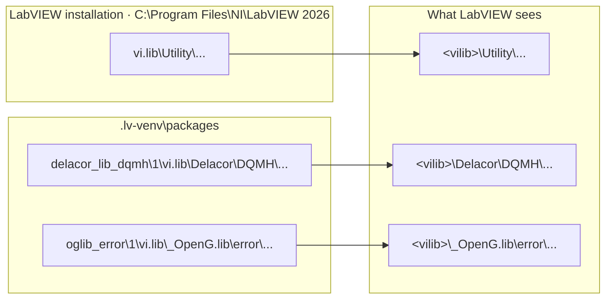
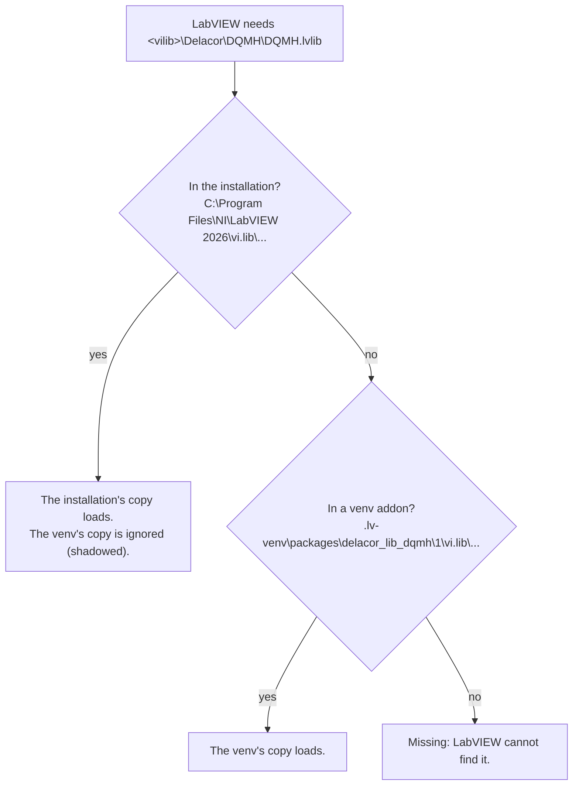

# How a venv works

A venv gives a project its own packages, the way a Python virtualenv or
`node_modules` does, instead of one `vi.lib` that every project on the
machine shares. Until now two projects that needed different versions of a
library meant two LabVIEW VMs or two machines. With a venv, the packages
live beside the project, LabVIEW mounts them as an overlay, and
`C:\Program Files` never changes.

This page explains the mechanism. The commands (`lvpm init`,
`lvpm venv create`, `lvpm launch`, `lvpm venv shortcut`) are in
[Per-project dependencies](usage.md#per-project-dependencies-venvs).

## Layout

```text
.lv-venv/
  packages/<pkg>/1/           one addon per package: its mirrored LabVIEW tree
  packages/venv-palettes/1/   the merged menus/ and vi.lib/addons/ palette files
  palettes/contributions/<pkg>/  each package's palette files, outside the mount
  installed/                  the install records
  hooks/                      the packages' hook VIs, kept but never run in a venv
  venv.json                   the LabVIEW binding
  labview.ini                 the venv LabVIEW's own settings
  objcache/ data/ temp/       the venv LabVIEW's compiled-object cache, LabVIEW Data and temp
```

A venv install unpacks and resaves each package in `.lv-venv.staging/`
beside the venv before moving it into `packages/`
([The resave](usage.md#the-resave)). The venv's log is in lvpm's log folder,
not in the venv ([Logs](usage.md#logs)).

## The overlay

`packages/` is an [LVAddons](https://labviewwiki.org/wiki/LVAddons)
location: one addon per package, each mirroring the LabVIEW installation
under `packages/<pkg>/1/`. `lvpm launch` starts LabVIEW with
`LVAddons.AdditionalLocations` pointing there, and LabVIEW overlays the
addons onto its own tree. A package in the venv resolves as `<vilib>/...`,
exactly as a globally installed one would, so the VIs you write against it
link portably. Needs LabVIEW 2024 Q1 or later.



The overlay only adds files; it never replaces one. For each path LabVIEW
looks in its own installation first and in the venv's addons second:



So a package that is also in the installation, from VIPM or an earlier
global install, loads from there, whatever version the venv holds. lvpm
warns about it after an install into the venv, at `lvpm launch` and in
`lvpm venv status`. It names every venv package whose LabVIEW files the
installation has too, and how to remove that copy. Only LabVIEW files count.

Two more things follow from LabVIEW reading the addons at launch:

- After `lvpm install`, a LabVIEW already open on the venv cannot see the new
  files. Restart it with `lvpm launch`. For the same reason the resave (and
  the relink, with `--relink`) runs in a LabVIEW that lvpm starts fresh on
  the venv, and is refused while one is already open there.
- The venv's LabVIEW is separate from your primary one. It has its own
  `labview.ini`, VI Server port, compiled-object cache, `LabVIEW Data` folder
  and temp folder, so the two never share autosave files, caches or logs.
  The venv starts with an empty `LabVIEW Data`, so personal customisations
  kept there (icon templates, right-click plugins) are not available in it.

A venv made by an older lvpm, with its files under `.lvpm/`, is refused:
close its LabVIEW, run `lvpm venv remove` and `lvpm venv create`, then
`lvpm install`.

## Palettes

Palette menus are the exception to one addon per package. LabVIEW shows
only one addon's copy of a folder, and packages share palette folders: the
`menus/` tree, and Addons palette categories such as `vi.lib/addons/HSE`. So
after each install or uninstall lvpm moves every package's `menus/` files and
the `.mnu` files under its `vi.lib/addons/` to `palettes/contributions/<pkg>/`
(the VIs beside them stay put) and publishes one merged addon,
`packages/venv-palettes/`.

- Byte-identical files are kept once.
- When packages ship different `dir.mnu` files at one path, the first package
  by name supplies it, and lvpm says how many differ (`--json` names them).
- Two packages that ship any other menu file with different contents refuse
  the merge and leave the published addon as it was.
- An addon that already matches is not rewritten, so a running venv LabVIEW
  is left alone. After a change lvpm says to restart it, since LabVIEW reads
  its palettes at startup.
- The package name `venv-palettes` is reserved. `lvpm launch` refuses a venv
  whose merged addon no longer matches its packages; `lvpm sync` rebuilds it.

lvpm keeps the menu tree's relative paths but does not read the contents of
a `.mnu` file. Absolute references and other paths inside one are not checked
and may not survive the move.

## Keeping the LabVIEW installation clean

A venv adds to the LabVIEW installation; it does not hide it. Everything in
the installation's `vi.lib` is still there when LabVIEW runs on a venv, and
that causes two problems:

- **Shadowing.** A package in both places loads from the installation, as
  described [above](#the-overlay).
- **Undeclared dependencies.** A project VI can link to a library that is
  installed in LabVIEW but not listed in `lvpm.toml`. It loads on that
  machine and breaks on a colleague's or in CI, where only what the manifest
  lists is installed. lvpm cannot catch this: `lvpm launch` checks the venv
  against `lvpm.lock`, not against what the project's VIs use.

So the LabVIEW installation should hold as few packages as possible:

- **Libraries your code calls** (frameworks, OpenG, toolkits, anything a
  project VI links to) go in each project's venv, not in LabVIEW.
- **Editor tools you use in every project** (Quick Drop plugins, menu
  add-ons, G-CLI) can stay in the installation, as long as no project VI
  calls into them.

To move an existing machine over, uninstall the libraries from LabVIEW (with
VIPM, or `lvpm uninstall --global <pkg>` for ones lvpm installed), then run
`lvpm sync` in each project. `lvpm venv status` lists any venv package the
installation still has a copy of.

Some packages assume they are installed into LabVIEW itself and do not work
in a venv, or need more than an install.
[Package notes](package-notes.md) lists the ones we have checked.
