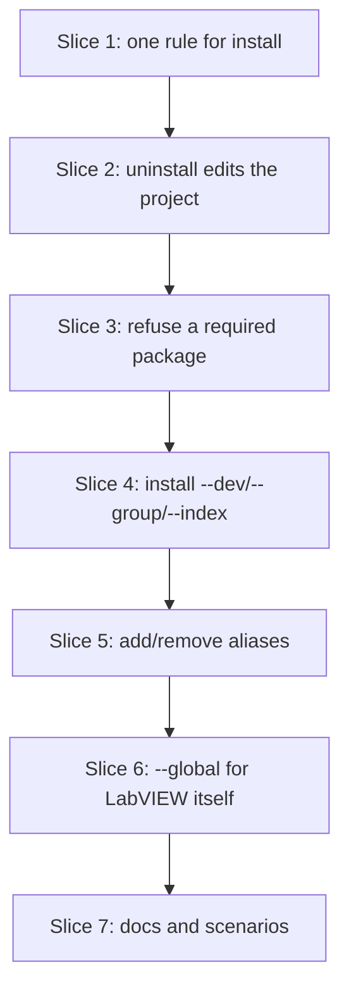

# Plan: Keep install and uninstall as the project commands (#54)

**Created**: 2026-11-25 (revision 4: revision 3 plus Slice 6, a write into LabVIEW itself needs --global)
**Branch**: slice/54-install-uninstall
**Status**: approved
**Gherkin persistence**: plan-file-only
**Base**: rebased onto integration/fork f9fda92 (#72, the #53 docs port, landed first; Slice 7 sweeps its new pages too: docs/venvs.md, docs/install.md, docs/labview-integration.md, ...)
<!-- The project's acceptance features live flat in tests/features/fork-adoption/
     and are listed in tests/acceptance.rs FEATURE_FILES; /build writes
     tests/features/fork-adoption/54-install-uninstall.feature as the first,
     failing test of Slice 1, and grows it slice by slice. -->

## Goal

In a project, `lvpm install <pkg>` and `lvpm uninstall <pkg>` are the commands
that change the project: both edit lvpm.toml, lock and sync. The destination
flags (`--prefix`, `--global`, `--labview-version`) only pick where the project
syncs, as on `sync`, `add` and `remove`. A direct install or uninstall that
leaves the project alone takes `--no-project`, as in uv. `add` and `remove` do
exactly what `install <pkg>` and `uninstall <pkg>` do in a project (decided
with the user 2026-11-25). Writing into a LabVIEW installation itself takes
`--global`; `--labview-version` only picks which LabVIEW (also decided
2026-11-25). Scope is labview-package-manager/lvpm#54; #68
(`--with`/`--without`/`--only`), #55 (asking before sync removes) and #50/#53
(docs) follow it.

## The rule

| Command | In a project | Outside a project |
|---|---|---|
| `install` | sync to lvpm.lock (into the destination flag's target, if any) | error: nothing to install |
| `install <pkg>` | add to lvpm.toml, lock, sync (into the destination flag's target, if any) | direct install |
| `install <pkg> --no-project` | direct install; lvpm.toml and lvpm.lock untouched | direct install |
| `uninstall <pkg>` | take out of lvpm.toml, lock, sync (into the destination flag's target, if any) | direct uninstall |
| `uninstall <pkg> --no-project` | direct uninstall; lvpm.toml and lvpm.lock untouched | direct uninstall |
| `uninstall --all`, bare `uninstall` | direct, as today | direct, as today |
| a write with `--labview-version YYYY`, no venv | error naming `--global` | error naming `--global` |
| a write with `--global [--labview-version YYYY]` | the project syncs into that LabVIEW | direct, into that LabVIEW |
| `add ...`, `remove ...` | clap aliases: exactly `install ...` / `uninstall ...` | exactly `install ...` / `uninstall ...` (direct) |

uv: `uv add`/`uv remove` always edit the project and fail outside one; a plain
install into an environment is `uv pip install`; `--project DIR` picks a
project and `--no-project` ignores it. `uv pip install` needs `--system` to
write into the system Python, as lvpm's writes need `--global`. lvpm already has the global
`--project DIR`; `--no-project` is its opposite, with the same meaning as in uv.

## Approach stances

| Axis | Stance |
|---|---|
| Scope | Only #54. `--with`, `--without`, `--only` get no meaning here (#68). No prompt before removal (#55). The docs/scenario sweep stays here: #54 asks for it. The `--global` rule was folded in by the user. One PR, as the user asked; the seven commits stay bisectable. |
| Replace vs merge | Reuse `ops::add_remove::{add, remove}` and `ops::install`/`ops::uninstall`; only routing changes. No new op. |
| add/remove (user's decision 2026-11-25) | Pure clap aliases: `visible_alias = "add"` on `Install`, `visible_alias = "remove"` on `Uninstall`; `Cmd::Add`/`Cmd::Remove` are deleted. Accepted on purpose: outside a project `lvpm remove foo` uninstalls foo directly and `lvpm remove --all` uninstalls everything in the target, as `uninstall` does; bare `lvpm add` syncs; `--json` reports `"command": "install"`/`"uninstall"` (the dispatch arms' `Report::done` strings), so the `json-add`/`json-remove` goldens change. uv's `add`/`remove` refuse outside a project; lvpm's do not. |
| Real LabVIEW (user's decision 2026-11-25) | `--global` is required for every write into an installation: install, uninstall, sync, relink, add, remove, run-hooks. `--labview-version` picks which one; alone it fails naming `--global`. `--global` without `--labview-version` takes the manifest's `labview` in a project, else the only installation. Reads (`list`, `vi-*`, linkfix, launch), `venv create`, `init`, `refresh` and `start` are unchanged. Headless counts as consent, with or without lvpm.toml. The TUI's no-venv install is refused. |
| Destination flags | Pick the target only. A named `install`/`uninstall` in a project edits the project whatever the destination flag. |
| Opt-out | `--no-project` on `install` and `uninstall`: `requires = "package"`, `conflicts_with = "project"`. Outside a project it is accepted and changes nothing. It conflicts with the saving flags (`--dev`, `--index`; `--group` with a package is refused in `install_mode`). |
| Behaviour change (release note #58, PR body list) | (1) `install x --prefix/--global/--labview-version` inside a project now edits lvpm.toml. (2) `uninstall x` of a package the project lists now takes it out of lvpm.toml. (3) `uninstall x` of a package another locked one requires fails. (4) `uninstall x` in a project, x not listed, fails. (5) `--keep-deps`/`--force` need `--no-project` in a project. (6) `add`/`remove` outside a project install/uninstall directly instead of refusing. (7) `--json` names `add`/`remove` as `install`/`uninstall`. (8) `--labview-version YYYY` alone no longer writes into LabVIEW YYYY; add `--global` (the 0.3.1 README form `lvpm install x --labview-version 2026` fails with that hint). (9) `--global` alone picks the venv's, the manifest's or the only LabVIEW instead of failing. (10) The TUI no longer installs into the newest LabVIEW when there is no venv. (11) Outside a project `install x --manifest y` fails with "--manifest cannot be used with a package name" (exit 1; clap's `manifest conflicts_with = "package"` was removed, so it is no longer clap's exit 2). |
| Upgrader signal | When a named project install or uninstall was given a destination flag, it prints: "note: in a project, --prefix picks where the project syncs; lvpm.toml gets x. Pass --no-project to install without changing the project." (flag named as typed; present tense, as it is printed before the add runs, which can still fail, and `--dry-run` writes nothing). `--labview-version` is named only when no venv wins: `OpEnv::destination` lets a venv at or above the cwd beat it. A plain `install x` prints the existing "adding x to lvpm.toml" line without the opt-out. |
| `uninstall` flags in a project | `--with-deps` is what happens anyway, so it is accepted. `--keep-deps` and `--force` are refused, naming `--no-project`: the lock decides what stays, and a sync would undo either. uv has neither on `uv remove`. |
| `uninstall` gains `remove`'s flags | `--dev`, `--group` and flattened `ApplyArgs`. On a direct route `--dev`, `--group` and the `ApplyArgs` bools (`--dry-run`, `--no-linkfix`, `--relink`, `--hooks`) are refused ("only a project uninstall takes it"); the `RelinkArgs` values are ignored there, as they cannot be told from their defaults. Direct uninstall takes none of these today, so nothing that works breaks. |
| `--group` on install | With a package it names the table to save into; without one it keeps meaning "also install this group". The help says both; a wrong use says which meaning applied. #68 may move the second meaning to `--with`. `asks_for_and_against_dev` (main.rs:875) only checks the sync meaning. |
| "required by" messages | The project route's `EditError::Required` and the direct route's existing error render through one function in `render::edit`, so they cannot drift. |
| Integration | One PR into `integration/fork`, squash, body says `Part of #54` (docs/fork-adoption.md); the issue is closed by hand after merge. #59 also edits `Cmd::Install`: if #59 lands first, this branch rebases onto it. |

## Acceptance Criteria

- [ ] `lvpm install caraya` and `lvpm install caraya --prefix other` in a project add caraya to lvpm.toml and lvpm.lock and sync the project (into "other" for the second). `crates/lvpm-core/src/ops/route.rs` unit tests `named_in_a_project_with_global_is_add`, `..._with_labview_version_is_add`, `..._with_prefix_is_add` cover the other flags.
- [ ] `lvpm install caraya --no-project --prefix dest` in a project installs caraya into dest and leaves lvpm.toml and lvpm.lock byte-identical; `--no-project --no-deps` works too.
- [ ] `lvpm uninstall alpha` in a project takes it out of lvpm.toml and lvpm.lock and uninstalls it and what only it needed (issue scenario 1); `--no-project` uninstalls directly and leaves both files byte-identical.
- [ ] `lvpm install alpha --dev` saves to `[dev-dependencies]`; `--group NAME` to `[dependency-groups.NAME]`; `--index NAME` writes the pin and lvpm.lock takes alpha from that source (issue scenario 2).
- [ ] `lvpm uninstall lib`, where locked "app" requires "lib", fails with "lib is required by installed packages: app", ends with one `next:` line naming every root that requires it (`next: run 'lvpm uninstall app' and 'lvpm uninstall app2' first`), and changes nothing, whether or not lvpm.toml lists "lib", and under `--dry-run` too (issue scenario 3).
- [ ] `uninstall --dev`/`--group` take a package out of that table; a wrong table fails naming the right one; a package in two tables comes out of one.
- [ ] In a project, `install x --no-deps|--manifest` and `uninstall x --keep-deps|--force` fail with a `next:` line naming `--no-project`. On a direct uninstall, `--dev`, `--group`, `--dry-run`, `--no-linkfix`, `--relink` and `--hooks` fail naming the flag (the `RelinkArgs` values are ignored, as Slice 2 says). All of these change nothing.
- [ ] Bare `lvpm install --group test` still means "also install group test".
- [ ] `lvpm add`/`lvpm remove` are clap aliases of `install`/`uninstall`: same flags and result in and outside a project, `--json` reports install/uninstall, `lvpm --help` lists the aliases.
- [ ] Every existing scenario and step that ran a named install/uninstall with a destination flag inside a project, to install directly, passes `--no-project`, and its recorded output is unchanged apart from the command line. The panic run of Step 1.1 lists none left.
- [ ] Outside a venv, a write with `--labview-version` alone fails naming `--global` and changes nothing; with `--global` it writes into that LabVIEW; `--global` alone takes the manifest's `labview`, else the only installation, else asks "which LabVIEW?"; `list --labview-version` still reads without `--global`; headless writes need no `--global`; `run-hooks` follows the same rule; the TUI's no-venv install fails naming `lvpm install <name> --global`.
- [ ] `grep -rnE "lvpm (install|uninstall|sync|relink|run-hooks)\b.*--labview-version" README.md docs/*.md docs/tutorial` matches only lines that also contain `--global`, or the docs/ci-docker.md headless lines, which the PR lists by name.
- [ ] Outside plans/, docs/specs/ and docs/vision/, `grep -rnE --exclude-dir=specs --exclude-dir=vision "lvpm (add|remove)\b"` over docs/ and src/ matches only the alias sentence in docs/usage.md; in tests/ only the alias scenarios and slice-13's kept alias scenarios.

"Nothing changed" in the scenarios below is the existing step: lvpm.toml and lvpm.lock bytes and the installed set are as before (tests/steps/add_remove.rs).

## Slices

### Slice 1: one rule for a named install

**Depends-on:** none
**Files:** `src/main.rs`, `crates/lvpm-core/src/ops/route.rs`, `crates/lvpm-core/src/events.rs`, `src/render/edit.rs`, `src/render/sync.rs`, `tests/features/fork-adoption/54-install-uninstall.feature`, `tests/acceptance.rs`, `tests/steps/add_remove.rs`, `tests/features/**/*.feature`, `tests/steps/*.rs`, `tests/support/sandbox.rs`, `tests/golden/**`

**Behavior:**

```gherkin
Feature: install and uninstall are the project commands

  Background:
    Given fixture packages "alpha" 1.0, "app" 1.0 requiring "lib" >= 1.0, "app2" 1.0 requiring "lib" >= 1.0, "lib" 1.0, "caraya" 1.0
    And a project with labview "2024" depending on "alpha" "*", locked and synced into scratch destination "dest"

  # Every command here that reaches a destination names one: a project with no
  # venv has none of its own, and the sandbox never writes into a LabVIEW.
  # "the output does not mention --no-project" is covered by the renderer unit
  # test in src/render/edit.rs, not here.
  Scenario: a named install edits the project
    When I run "lvpm install caraya --prefix dest"
    Then lvpm.toml says "caraya" = ">=1.0"
    And lvpm.lock and dest include "caraya" 1.0
    And the output says "adding caraya to lvpm.toml"

  Scenario: a destination flag picks where the project syncs, and install still edits it
    When I run "lvpm install caraya --prefix other"
    Then lvpm.toml says "caraya" = ">=1.0"
    And lvpm.lock and "other" include "caraya" 1.0 and "alpha" 1.0
    And the output says "in a project, --prefix picks where the project syncs" and names "--no-project"

  Scenario: --no-project installs without touching the project
    When I run "lvpm install caraya --no-project --prefix dest"
    Then dest includes "caraya" 1.0
    And lvpm.toml and lvpm.lock are byte-identical to before

  Scenario: --no-project takes the options a lock cannot honour
    When I run "lvpm install app --no-project --no-deps --prefix dest"
    Then dest includes "app" 1.0
    And dest does not include "lib"
    And lvpm.toml and lvpm.lock are byte-identical to before

  Scenario Outline: options a lock cannot honour name --no-project
    When I run "lvpm install caraya <flag>"
    Then the command fails saying <flag> cannot be used in a project, because lvpm.lock decides the dependencies
    And the error's next line names "--no-project"
    And nothing changed

    Examples:
      | flag              |
      | --no-deps         |
      | --manifest x.toml |

  Scenario: an unknown package changes nothing
    When I run "lvpm install zeta --prefix dest"
    Then the command fails saying "zeta" is in no configured source
    And nothing changed

  Scenario Outline: --no-project needs a package, and is not --project
    When I run "lvpm <args>"
    Then the command fails naming "<names>"
    And nothing changed

    Examples:
      | args                                  | names        |
      | install --no-project                  | <PACKAGE>    |
      | install caraya --no-project --project . | --project  |

  Scenario: --no-project outside a project is a direct install, as without it
    Given a directory without lvpm.toml
    When I run "lvpm install caraya --no-project --prefix dest"
    Then dest includes "caraya" 1.0
```

Bare `install` in and outside a project, and a named install outside one, stay covered by slice-13 ("lvpm install" row of "lock-editing commands outside a project are refused", "install with a name outside a project is unchanged") and are not repeated.

**Steps:**

#### Step 1.1: Route a named install by --no-project, not by destination flag

**Complexity**: complex (routing change plus a repo-wide migration)
**IMPLEMENT**: `InstallRequest` gains `no_project: bool`. `install_mode`: a named package is `Add` in a project unless `no_project`; the destination-flag test goes. `Cmd::Install` gets `--no-project` (`requires = "package"`, `conflicts_with = "project"`) and loses `manifest conflicts_with = "package"`, so `install_mode` refuses the pair with the same text in a project or outside one. `Event::InstallAddsToProject` gains `destination: Option<String>` (the flag as typed); its rendering adds the upgrader note only when it is set. `NotWithLock` text: "{flag} cannot be used in a project, because lvpm.lock decides the dependencies", next line `lvpm install <package> {flag} --no-project ...`. New steps in tests/steps/add_remove.rs: `lvpm.toml says`, `lvpm.lock and <dest> include`, `<dest> includes`/`does not include`, `the error's next line names`, the multi-package fixture with `requiring`; widen `the command fails naming "..."` (add_remove.rs:846) to accept a single token.
**TEST**: The scenarios above, file added to `FEATURE_FILES`. `route.rs` unit tests named in the first criterion, plus `no_project` is `Additive` in and outside a project. Then migrate: every scenario, step and sandbox helper that runs a named `install` with a destination flag inside a project to install directly gets `--no-project`. Find them with both orders (`install [a-z_]* .*--(prefix|global|labview-version)` and `install .*--(prefix|global|labview-version).* [a-z_]+`) and the `&["install", ...]` arrays in tests/steps and tests/support. Then a one-off check, not committed: make `InstallMode::Add` panic when a destination flag is set, run the suite, and confirm every panic is a scenario meant to edit the project. Golden outputs keep their bytes; only a recorded command line may change. slice-13's outline "install with a name and an explicit destination stays additive" becomes "--no-project keeps a named install additive", and its `@unsafe` `--global` scenario gets `--no-project`. Full suite green.
**REFACTOR**: Drop the now unused destination test from `install_mode`.
**Files**: `src/main.rs`, `crates/lvpm-core/src/ops/route.rs`, `crates/lvpm-core/src/events.rs`, `src/render/edit.rs`, `src/render/sync.rs`, `tests/features/fork-adoption/54-install-uninstall.feature`, `tests/acceptance.rs`, `tests/steps/add_remove.rs`, `tests/features/**/*.feature`, `tests/steps/*.rs`, `tests/support/sandbox.rs`, `tests/golden/**`
**Commit**: `feat(install): a named install in a project edits it, whatever the destination; --no-project opts out (#54)`

### Slice 2: uninstall in a project edits the project

**Depends-on:** 1
**Files:** `src/main.rs`, `crates/lvpm-core/src/ops/route.rs`, `crates/lvpm-core/src/errors.rs`, `src/render/edit.rs`, `src/render/sync.rs`, `tests/features/fork-adoption/54-install-uninstall.feature`, `tests/steps/add_remove.rs`, `tests/features/**/*.feature`, `tests/steps/*.rs`, `tests/support/sandbox.rs`, `tests/golden/**`

**Behavior:**

```gherkin
  Scenario: uninstall takes the package out of the project
    When I run "lvpm uninstall alpha"
    Then "alpha" is gone from lvpm.toml, lvpm.lock and dest
    And the output says "removing alpha from lvpm.toml"

  Scenario: uninstall drops what only that package needed
    Given the project also depends on "app" "*", locked and synced
    When I run "lvpm uninstall app"
    Then "app" is gone from lvpm.toml, lvpm.lock and dest
    And "lib" is gone from lvpm.lock and dest

  Scenario: uninstall keeps what another package still needs
    Given the project also depends on "app" "*", locked and synced
    And the project also depends on "app2" "*", locked and synced
    When I run "lvpm uninstall app"
    Then "app" is gone from lvpm.toml, lvpm.lock and dest
    And "lib" stays in lvpm.lock and dest

  Scenario: a destination flag picks where uninstall syncs
    Given the project is also synced into scratch destination "other"
    When I run "lvpm uninstall alpha --prefix other"
    Then "alpha" is gone from lvpm.toml, lvpm.lock and "other"
    And dest still includes "alpha" 1.0
    And the output says "in a project, --prefix picks where the project syncs" and names "--no-project"

  Scenario: --with-deps is accepted in a project
    When I run "lvpm uninstall alpha --with-deps"
    Then "alpha" is gone from lvpm.toml, lvpm.lock and dest

  Scenario: uninstall --dev takes a dev dependency out
    Given dev dependency "caraya" ">=1.0", locked and synced
    When I run "lvpm uninstall caraya --dev"
    Then "caraya" is gone from [dev-dependencies], lvpm.lock and dest

  Scenario: uninstall --group takes a package out of that group
    Given lvpm.toml has [dependency-groups.test] "caraya" "*", locked and synced
    When I run "lvpm uninstall caraya --group test"
    Then "caraya" is gone from [dependency-groups.test], lvpm.lock and dest

  Scenario Outline: uninstall from the wrong table names the right one
    Given <given>
    When I run "lvpm uninstall caraya <flag>"
    Then the command fails saying "caraya" is in <table>
    And nothing changed

    Examples:
      | given                                                          | flag         | table                     |
      | dev dependency "caraya" ">=1.0", locked and synced             |              | [dev-dependencies]        |
      | lvpm.toml has [dependency-groups.test] "caraya" "*", locked and synced | --group ci | [dependency-groups.test] |
      | the project also depends on "caraya" "*", locked and synced    | --dev        | [dependencies]            |

  Scenario: a package listed in two tables comes out of one
    Given the project also depends on "caraya" "*", locked and synced
    And dev dependency "caraya" ">=1.0", locked and synced
    When I run "lvpm uninstall caraya --dev"
    Then "caraya" is gone from [dev-dependencies]
    And "caraya" stays in lvpm.lock and dest

  Scenario: uninstall of an installed name the project does not list names --no-project
    Given "caraya" 1.0 is installed in dest with "lvpm install caraya --no-project --prefix dest"
    When I run "lvpm uninstall caraya"
    Then the command fails with: caraya is not a dependency of this project
    And the error's next line names "lvpm uninstall caraya --no-project"
    And nothing changed

  Scenario: uninstall of a name that is nowhere suggests a typo
    When I run "lvpm uninstall zeta"
    Then the command fails with: zeta is not a dependency of this project
    And the error's next line says to check the name
    And the error does not mention "--no-project"
    And nothing changed

  Scenario Outline: flags the lock overrules are refused in a project
    When I run "lvpm uninstall alpha <flag>"
    Then the command fails naming "<flag>"
    And the error's next line names "--no-project"
    And nothing changed

    Examples:
      | flag        |
      | --keep-deps |
      | --force     |

  Scenario: uninstall --no-project needs a package
    When I run "lvpm uninstall --no-project"
    Then the command fails naming "<PACKAGE>"
    And nothing changed

  Scenario Outline: --no-project and --all keep uninstall direct
    When I run "lvpm uninstall <args>"
    Then "alpha" is uninstalled from dest
    And lvpm.toml and lvpm.lock are byte-identical to before

    Examples:
      | args                                         |
      | alpha --no-project --prefix dest             |
      | alpha --no-project --keep-deps --prefix dest |
      | --all --prefix dest                          |

  Scenario: a bare uninstall in a project stays direct
    When I run "lvpm uninstall --prefix dest"
    Then it behaves as before this change
    And lvpm.toml and lvpm.lock are byte-identical to before

  Scenario Outline: project-only flags on a direct uninstall are refused
    When I run "lvpm uninstall <args>"
    Then the command fails naming "<flag>"
    And nothing changed

    Examples:
      | args                                              | flag         |
      | alpha --dev --no-project --prefix dest            | --dev        |
      | alpha --group test --no-project --prefix dest     | --group      |
      | alpha --dry-run --no-project --prefix dest        | --dry-run    |
      | alpha --no-linkfix --no-project --prefix dest     | --no-linkfix |
      | --all --dev --prefix dest                         | --dev        |

  Scenario: a direct uninstall of a listed package says it is still listed
    When I run "lvpm uninstall alpha --no-project --prefix dest"
    Then the output says "alpha" is still in lvpm.toml and "lvpm uninstall alpha" removes it for good
```

"it behaves as before this change" is the existing slice-1 characterization row for a bare uninstall, if one exists; otherwise the step asserts its current exit code and message, recorded before the change.

**Steps:**

#### Step 2.1: Route a named uninstall in a project to remove

**Complexity**: complex (routing change plus migration)
**IMPLEMENT**: In `route.rs`, `UninstallRequest { package, all, no_project, keep_deps, force, table_flag, apply_flag }` and `uninstall_mode(env, &request) -> Result<UninstallMode { Project, Direct }, RouteError>` beside `install_mode`. Project: named, no `--all`, no `--no-project`, inside a project; `keep_deps`/`force` there are a `RouteError` whose next line names `--no-project`. Direct with `table_flag` or `apply_flag` (the `ApplyArgs` bools) is a `RouteError` too. `Cmd::Uninstall` gets `--no-project` (`requires = "package"`, `conflicts_with = "project"`), `--dev`, `--group` (both conflict with `--all` in clap, and the refusal covers `--no-project`) and flattened `ApplyArgs`. The dispatch arm matches the mode first and calls `cmd_remove` for Project, before building `ask`/`deps`. `NotADependency` for an uninstall reads "x is not a dependency of this project"; its next line names `lvpm uninstall x --no-project` when x is installed in the target, else "check the name". `UninstalledStillListed` names `lvpm uninstall <pkg>`. The upgrader note of Slice 1 fires for a destination flag here too. New step: "the project is also synced into scratch destination ...".
**TEST**: The scenarios. `route.rs` unit tests: named in a project is Project with or without a destination flag; `no_project`, `--all`, bare, no project are Direct; each refusal. Migrate every scenario and step that runs a named direct `uninstall` inside a project to `--no-project` (slice-1 characterization rows 33, 34 and 147; slice-13 "uninstall inside a project hints at remove", which now says "lvpm uninstall beta"), with the same two-order grep and a panic run as in Step 1.1. Full suite green.
**REFACTOR**: Keep the dispatch arm no longer than today.
**Files**: `src/main.rs`, `crates/lvpm-core/src/ops/route.rs`, `crates/lvpm-core/src/errors.rs`, `src/render/edit.rs`, `src/render/sync.rs`, `tests/features/fork-adoption/54-install-uninstall.feature`, `tests/steps/add_remove.rs`, `tests/features/**/*.feature`, `tests/steps/*.rs`, `tests/support/sandbox.rs`, `tests/golden/**`
**Commit**: `feat(uninstall): a named uninstall in a project takes it out of lvpm.toml (#54)`

Between Slice 2 and Slice 3, a project uninstall of a required package still keeps it locked with a note (today's `remove`). Slice 3 lands in the same PR.

**Built differently in Step 2.1** (decided while building and reviewing; the scenarios and tests are the record):

- The scenarios name a destination (`--prefix dest`), because a project with no venv has none and the sandbox never writes into a LabVIEW. The `--group` Given reuses the existing manifest step ("lvpm.toml has [dependency-groups.test] ... synced with ..."). Outline row 2 of the wrong-table outline uses `--dev`; an undefined group (`uninstall caraya --group ci`) has its own scenario and names `unknown group 'ci'`.
- A bare `uninstall` in a project fails "give a package name, or --all", as before; it is direct, not a sync.
- Wording the plan did not give:
  - "removing X from lvpm.toml and syncing the project to lvpm.lock" is the first line, and is said only once X is known to be in the table being edited (`add_remove::remove_announcing`); a refusal (not a dependency, wrong table, not in the group, unknown group) says none of it. Under `--dry-run` both it and the install line say "would remove X from ... and sync" / "would add X to ... and sync" (`dry_run` on both events). The upgrader note under it is not reworded for a dry run.
  - `--keep-deps` and `--force` in a project: "{flag} cannot be used in a project, because lvpm.lock decides what stays", next line names `--no-project`.
  - A project-only flag on a direct uninstall (`OnlyInAProject`) says why the uninstall is direct: no package ("drop F, or name a package"), `--no-project` ("drop F, or drop --no-project"), or no lvpm.toml found (the "run this in a project" text).
  - `NotADependency` for an installed name has the next line `lvpm uninstall x --no-project` plus the destination flags as typed, with values (`--prefix dest`, `--global`, `--labview-version 2026`); so do the `UninstalledStillListed` note and the other-table hints. They are listed in the order that decides the target: `--prefix`, `--labview-version` (not when a venv wins and `--global` is absent), `--global`. The `NotInGroup` hint (`lvpm add x --group g`) did not carry them until Step 3.1.
- The other-table hints use the verb the user ran: `lvpm uninstall x --dev` for `uninstall`, and `lvpm remove` stays `lvpm remove` for `lvpm remove` until Slice 5.
- `--no-relink` (hidden, a no-op on every command) is not refused on a direct uninstall. `--relink-timeout` is not either: it has a default, so a typed one cannot be told from none without carrying clap's `value_source` to `flag_given`; `--keep-open` and `--relink-progress` are refused. Both are marked with a `shortcut:` comment on `ApplyArgs::flag_given`.
- Slice-1 characterization rows 34 and 147 need no migration: they run in a directory with no project. `tests/support/sandbox.rs` (`restore_labview_installation`) gets `--no-project`, since the work directory can hold a scenario's project.
- `remove`'s not-a-dependency probe (`installed_in_the_target`) finds the venv and the roots without `destination()`, so it adds no `VenvSelected` event. A headless, venv-less project is not probed there, and reads as holding nothing.
- tests/venv.rs: `uninstall_keeps_packages_dependencies_and_the_manifest_in_step` is split. The Slice 2 half runs (`uninstall_in_a_project_takes_the_package_out_of_the_manifest_and_all_leaves_it`); the required-by half stays ignored as `#[ignore = "#54 slice 3"]`. `install_by_name_keeps_the_manifest_in_step` waits on `#54 slice 4`. `uninstall_takes_the_named_package_out_of_the_manifest_even_when_a_dependency_fails` asserted upstream's behaviour, which the fork does not share (upstream keeps the manifest edit when the sync stops partway, the fork puts lvpm.toml and lvpm.lock back and says so), so it stayed ignored for a while; Step 3.1 rewrote it as `an_uninstall_whose_sync_stops_puts_lvpm_toml_and_lvpm_lock_back`.

### Slice 3: a package another one requires cannot be removed

**Depends-on:** 2
**Files:** `crates/lvpm-core/src/ops/add_remove.rs`, `crates/lvpm-core/src/ops/uninstall.rs`, `crates/lvpm-core/src/lockfile.rs`, `crates/lvpm-core/src/errors.rs`, `crates/lvpm-core/src/events.rs`, `src/render/edit.rs`, `src/render/mod.rs`, `tests/features/fork-adoption/54-install-uninstall.feature`, `tests/features/lvpm-lockfile/slice-13-lvpm-add-lvpm-remove-install-pkg-routing.feature`, `tests/steps/add_remove.rs`

**Behavior:**

```gherkin
  Scenario: uninstall of a package another one requires, not listed itself
    Given the project also depends on "app" "*", locked and synced
    When I run "lvpm uninstall lib"
    Then the command fails with: lib is required by installed packages: app
    And the error's next line says to run "lvpm uninstall app" first
    And nothing changed

  Scenario: uninstall of a listed package another one requires
    Given the project also depends on "app" "*", locked and synced
    And the project also depends on "lib" "*", locked and synced
    When I run "lvpm uninstall lib"
    Then the command fails with: lib is required by installed packages: app
    And the error's next line says to run "lvpm uninstall app" first
    And nothing changed

  Scenario: two packages require it
    Given the project also depends on "app" "*", locked and synced
    And the project also depends on "app2" "*", locked and synced
    When I run "lvpm uninstall lib"
    Then the command fails with: lib is required by installed packages: app, app2
    And the error's next line says to run "lvpm uninstall app" and "lvpm uninstall app2" first
    And nothing changed

  Scenario: --dry-run refuses it the same way
    Given the project also depends on "app" "*", locked and synced
    And the project also depends on "lib" "*", locked and synced
    When I run "lvpm uninstall lib --dry-run"
    Then the command fails with: lib is required by installed packages: app
    And the error's next line says to run "lvpm uninstall app" first
    And nothing changed

  Scenario: following the next line works
    Given the project also depends on "app" "*", locked and synced
    And the project also depends on "lib" "*", locked and synced
    When I run "lvpm uninstall app"
    And I run "lvpm uninstall lib"
    Then "app" and "lib" are gone from lvpm.toml, lvpm.lock and dest

  Scenario: the direct route says it the same way
    Given the project also depends on "app" "*", locked and synced
    When I run "lvpm uninstall lib --no-project --prefix dest"
    Then the command fails with: lib is required by installed packages: app
    And nothing changed
```

**Steps:**

#### Step 3.1: Refuse the removal before anything is written

**Complexity**: standard
**IMPLEMENT**: `Lockfile::dependents_of(name) -> Vec<String>` (sorted: the locked packages whose `requires` names it) and the roots among them, walked up to packages a table lists. New `EditError::Required { name, required_by, roots }`. One render function in `render::edit` prints "{name} is required by installed packages: {list}" plus one line "next: run `lvpm uninstall {root}` [and `lvpm uninstall {root2}` ...] first" naming every root; the direct route's existing error in `ops/uninstall.rs` goes through it too (its `--force` next line stays). In `remove`: a name in no table that the previous lock holds with non-empty dependents is `Required`, not `NotADependency`. In `commit`, right after the relock and before the dry-run branch: for a removal, non-empty `dependents_of` in the new lock is `Required`. Empty dependents (still a root in another table) goes ahead. Delete `Event::PackageStillRequired` and its rendering.
**TEST**: The scenarios. In `add_remove.rs`, rewrite `a_package_another_one_requires_stays_locked_installed_and_is_said_to_be_required` to assert `EditError::Required { name: "alpha", required_by: ["beta"], .. }` and byte-identical manifest, lock and destination; move `a_cancel_accepted_once_the_lock_is_made_...` to a package nothing requires. Change slice-13's "remove keeps a package another one still requires" to the refusal. Full suite green.
**REFACTOR**: `announce_edit` loses its inline dependents filter.
**Files**: `crates/lvpm-core/src/ops/add_remove.rs`, `crates/lvpm-core/src/ops/uninstall.rs`, `crates/lvpm-core/src/lockfile.rs`, `crates/lvpm-core/src/errors.rs`, `crates/lvpm-core/src/events.rs`, `src/render/edit.rs`, `src/render/mod.rs`, `tests/features/fork-adoption/54-install-uninstall.feature`, `tests/features/lvpm-lockfile/slice-13-lvpm-add-lvpm-remove-install-pkg-routing.feature`, `tests/steps/add_remove.rs`
**Commit**: `feat(uninstall): refuse to remove a package another one requires (#54)`

**Built differently in Step 3.1** (decided while building; the scenarios and tests are the record):

- The scenarios name a destination (`--prefix dest`), as Slices 1 and 2 do, so the `next:` line carries it: "next: run `lvpm uninstall app --prefix dest` first". The step checks each named command is followed only by flags.
- A root is a package nothing requires. Each direct dependent is climbed on its own and a climb passes over a package that is itself required (listed and required: removing it is refused too); a dependent whose climb reaches no top, because it is in a cycle, is named itself, beside the roots other climbs find. The direct route walks the installed records the same way (`dependency::roots_above`).
- The direct route's refusal is the typed `EditError::Required` inside the `anyhow` error; `main` renders it with `render::edit::direct_error`, so both routes share `render::edit::required`. Its `next:` is still one line: "next: run `lvpm uninstall app --no-project --prefix dest` first, or pass --force to remove lib anyway" (`--no-project` only when typed).
- `EditError::Required` Display is the first line, so the message is the same on both routes. `PackageStillRequired` and its rendering are deleted; `announce_edit` lost its dependents filter and its `lock` parameter.
- The announce events (`InstallAddsToProject`, `UninstallRemovesFromProject`) are said by core in `commit`, after the relock and the `Required` check, so a refusal says none of it. They are no longer the first output line: the resolve lines come before them. Slice-13's "the first output line says gamma is being added" (a `@labview` scenario) says "the output says" now, and `both manifests, locks and destinations are identical` drops install's own two lines (`adding ...`, `note: in a project, ...`) instead of the first line.
- A name in no table that the previous lock holds with dependents is `Required` before the destination is looked up; a name in a table is checked on the new lock.
- tests/venv.rs: `uninstall_keeps_packages_dependencies_and_the_manifest_in_step` was only its required-by half and is now `uninstall_refuses_a_package_another_one_requires_and_a_script_must_say_what_happens_to_dependencies` (runs). Its prompt check needed a manifest that does not declare `app`, since a declared package keeps its dependencies and nothing is left to ask about.

**Fixes after the Step 3.1 review:**

- A project's `next:` line names each root with the table flag `uninstall` needs: a root in `[dev-dependencies]` is `lvpm uninstall app --dev`, one in `[dependency-groups.ci]` is `lvpm uninstall app --group ci`, and a root listed in several tables gets one command for each, all in the one line. `EditError::Required.roots` is `Vec<(String, Vec<DependencyTable>)>`: core looks the tables up in the project (`add_remove::required`); the direct route has none and keeps bare names (`render::edit::error` builds each command with `command_for`). New scenario: a root in `[dev-dependencies]`, where running the line works.
- `dependency::roots_above` decides the cycle fallback per direct dependent, not only when no root is found at all: with app and x listed, x and y requiring each other, and both app and x requiring lib, it names app and x.
- `SyncLockMissing` ("no lvpm.lock found: writing one ...") is said in `commit` after the `Required` check, next to the announce, so a refusal in a project with no lock says nothing about writing one. In the `@labview` goldens `venv-install-beta`, `venv-install-vi-fixture` and `venv-install-vi-fixture-headless` that line now comes before "adding X to lvpm.toml ...", and the "(to install it without changing the project, pass ...)" text is gone. They were edited by hand, not re-recorded: those rows need a LabVIEW 2026 that this change did not start, so they are unverified until someone runs them with `LVPM_TEST_LABVIEW`.
- docs/usage.md says a required package is refused. `e2e/src/local.rs` `uninstall_required_package` asserts the refusal and then `--force` (both with `--no-project`, the direct route it was written for). tests: the announce-not-on-refusal tests include `--dry-run`, and the rollback test checks lvpm.lock is byte-identical.

**Also in this step** (carry-over from the Slice 2 review):

- a. A named install says "adding X to lvpm.toml and syncing ..." only once the lock is made (`add_remove::add_announcing`, core emits it), so an unknown package says none of it; the unknown-package scenario adds `And the output does not say "adding"`.
- b. Under `--dry-run` the destination note says "lvpm.toml would get X" / "would lose X" (unit test in `src/render/edit.rs`).
- c. The `NotInGroup` hint carries the destination flags as typed, like the other hints (unit test).
- d. tests/venv.rs `uninstall_takes_the_named_package_out_of_the_manifest_even_when_a_dependency_fails` asserted upstream's behaviour. It is now `an_uninstall_whose_sync_stops_puts_lvpm_toml_and_lvpm_lock_back`: lvpm.toml and lvpm.lock are as they were, the output says "lvpm.toml and lvpm.lock were put back as they were", and the dependency that failed stays recorded. No equivalent existed at the CLI level (core has `a_sync_that_fails_part_way_puts_the_manifest_and_the_lock_back`, which runs `add`).

### Slice 4: install saves into dev, a group or a source

**Depends-on:** 3
**Files:** `src/main.rs`, `crates/lvpm-core/src/ops/route.rs`, `crates/lvpm-core/src/errors.rs`, `tests/features/fork-adoption/54-install-uninstall.feature`, `tests/features/sources/s7c-pinned-sources.feature`, `tests/features/lvpm-lockfile/slice-17-dependency-groups.feature`

**Behavior:**

```gherkin
  Scenario: install can save into the dev group
    When I run "lvpm install caraya --dev"
    Then [dev-dependencies] says "caraya" = ">=1.0"
    And lvpm.lock and dest include "caraya" 1.0

  Scenario: install --group saves into that group
    When I run "lvpm install caraya --group test"
    Then lvpm.toml has a new [dependency-groups.test] with "caraya" = ">=1.0"
    And lvpm.lock and dest include "caraya" 1.0

  Scenario: install --dev with a destination flag saves and syncs there
    When I run "lvpm install caraya --dev --prefix other"
    Then [dev-dependencies] says "caraya" = ">=1.0"
    And "other" includes "caraya" 1.0

  Scenario: install --dev of a package [dependencies] lists adds it there too
    Given the project also depends on "caraya" "*", locked and synced
    When I run "lvpm install caraya --dev"
    Then [dev-dependencies] says "caraya" = ">=1.0"
    And [dependencies] itself has the "caraya" line

  Scenario: a bare install --group still installs that group
    Given lvpm.toml has [dependency-groups.test] "caraya" "*"
    When I run "lvpm install --group test"
    Then lvpm.lock and dest include "caraya" 1.0
    And lvpm.toml is byte-identical to before

  Scenario Outline: saving flags that do not fit are refused
    When I run "lvpm install <args>"
    Then the command fails naming "<names>"
    And nothing changed

    Examples:
      | args                               | names        |
      | caraya --group test --group ci     | one group    |
      | caraya --dev --group test          | --dev        |
      | caraya --dev --no-dev              | --dev        |
      | --dev                              | --dev        |
      | --index second                     | --index      |
      | caraya --dev --no-project          | --no-project |
      | caraya --group test --no-project   | --no-project |
      | caraya --index second --no-project | --no-project |
```

In `s7c-pinned-sources.feature`, on its Background (`a project with labview "2024" whose [sources] are "first" then "second"`), beside the `lvpm add --index` scenarios:

```gherkin
  Scenario: lvpm install --index writes the table form with the pinned source's version
    Given "first" lists "alpha" 2.0
    And "second" lists "alpha" 1.0
    When I run "lvpm install alpha --index second --prefix dest"
    Then the command succeeds
    And lvpm.toml pins "alpha" to "second" with ">=1.0"
    And lvpm.lock takes "alpha" 1.0 from "second"
    And the output says "(from second)"

  Scenario: lvpm install --index naming an unknown source changes nothing
    Given "first" lists "alpha" 1.0
    When I run "lvpm install alpha --index nope --prefix dest"
    Then the error says "index = \"nope\" is not a [sources] name"
    And nothing changed
```

**Steps:**

#### Step 4.1: --dev, --group and --index on a named install

**Complexity**: standard
**IMPLEMENT**: `Cmd::Install` gets `--dev` (requires `package`, conflicts with `no_dev`, `group`, `no_project`) and `--index` (requires `package`, conflicts with `no_project`). Drop `"group"` from `package`'s `conflicts_with_all`; `--group` with a package and `--no-project` is refused in `install_mode` (clap cannot say "group only with a package"), naming which meaning applied. `--group` help: "With a package: save it in [dependency-groups.NAME]. Without: also install this group (repeatable)." The `InstallMode::Add` arm builds the table with `dependency_table(dev, group)` (two groups fail: "a package goes into one group") and passes `source_pin`.
**TEST**: The scenarios; a `route.rs` unit test for `--group` + `--no-project`. Full suite green, including slice-17's group scenarios (slice-17:144 `install beta --group ci --prefix dest` now saves beta into group ci: rewrite its Then to match its title's intent).
**REFACTOR**: Keep both match arms short.
**Files**: `src/main.rs`, `crates/lvpm-core/src/ops/route.rs`, `crates/lvpm-core/src/errors.rs`, `tests/features/fork-adoption/54-install-uninstall.feature`, `tests/features/sources/s7c-pinned-sources.feature`, `tests/features/lvpm-lockfile/slice-17-dependency-groups.feature`
**Commit**: `feat(install): --dev, --group and --index save a named install (#54)`

**Built differently in Step 4.1** (decided while building; the scenarios and tests are the record):

- A saving flag is refused on every direct install, not only `--group` with `--no-project`: `InstallRequest.saving_flag` (`--dev`, `--group` or `--index` as typed) and `install_mode` give the new `RouteError::SaveOnlyInAProject { flag, no_project }` when a named install is direct, either by `--no-project` or because there is no project. Without it `install x --dev` outside a project would have been accepted and the flag ignored (clap used to refuse `--group` there). The next line says `drop --no-project`, or `run this in a project, where installing a package adds it to lvpm.toml`; for `--group` it also says "(with no package it installs that group)", which names the other meaning. A bare `install --group test` is still a sync: the saving flag is only read with a package. `--dev` and `--index` with `--no-project` stay clap's conflict, as the plan says. New scenario outline for the outside-a-project rows; route unit tests for both routes.
- The scenarios name a destination, so the outline's `<args>` is followed by `--prefix dest`.
- The `--group` help is set on `Install` alone (`#[command(mut_arg("group", ...))]`): `SyncArgs` is shared, and `sync --group` keeps its own help.
- Two groups with a package fail in `main` with "a package goes into one group" (`saved_into`); `--group dev` is `--dev`, as for `add`. The `InstallMode::Add` arm is `saved_into` plus `cmd_install_adds`, which builds the announce and calls `cmd_add`, so the `Cmd::Install` arm stays small for #59's merge.
- Steps: "lvpm.toml has a new [dependency-groups.test] with ..." is the existing `[dependency-groups.test] says ...` plus "the output says created [dependency-groups.test], a new group". The unknown-source scenario in s7c uses the givens and Then steps of its `add` twin ("the project depends on alpha, a current lock, ... byte-identical") because "nothing changed" needs a noted project that s7c's Background does not make. The outside-a-project outline ends with "the working directory has no lvpm.toml" ("nothing changed" has no manifest to read there).
- slice-17:144 `install beta --group ci --prefix dest` now saves beta in group ci; its title and Then follow `add --group`: the table, the lock's `groups ["ci"]`, and beta installed.
- tests/venv.rs `install_by_name_keeps_the_manifest_in_step` runs. In a project a named install is an add and the lock decides, so three upstream checks are in the fork's words: `install foo@1.0.0.1` says "lvpm.toml: added foo = "1.0.0.1" to [dependencies]"; an upgrade is `install foo@2.0.0.1` (`install foo` with no version only rewrites the constraint to `>=` the locked version, as `add` does; `lock --upgrade-package` moves a locked package); "not downgrading" and a manifest that is left alone are the direct install's (`install foo@1.0.0.1 --no-project`), since `install foo@1.0.0.1` in a project downgrades the venv with the lock. `install baz --no-project` is the form that does not save, and the group line reads `bar = ">=1.0.0.1"`. The dry run says "would add foo@1.0.0.1 to lvpm.toml". Not covered: a project downgrade step.
- e2e/src/local.rs (not run: they need a LabVIEW container): every named `uninstall` that stood for the direct route, with `--keep-deps` or `--with-deps` and the direct route's wording ("--with-deps or --keep-deps", "keeping ...: still required by", "dependency list required", "declared in lvpm.toml"), gets `--no-project`. Its named installs are unchanged: they were adds already (no destination flag), and `--no-project` on them would change what the check sets up.

**Fixes after the Step 4.1 review:**

- Every saving flag given is named, not the first: `InstallRequest.saving_flags` is the list (`--dev`, `--group`, `--index`, in that order; `saving_flags` in main.rs) and `RouteError::SaveOnlyInAProject { flags, no_project }` carries it. Outside a project `install caraya --dev --index second` says "--dev and --index can only be used when installing a package into a project, which saves it in lvpm.toml" and "next: drop --dev and --index, or run this in a project, ...", so the line no longer sends the user into a second refusal over `--index`. The `--group` aside "(with no package it installs that group)" follows the list when `--group` is in it. The first sentence changed from "{flag} saves the package in lvpm.toml, so it can only be used when ..." because that sentence has no plural. New outline row `--dev --index second`; unit tests for `saving_flags`, `saved_into`, the route and the wording.
- The newer-LabVIEW hint (`EditError::Lock(NeedsNewerLabview)`) was always `lvpm add {name}@<version>`: it dropped the table, the `--index` pin and the destination flags. `render::edit::error` takes the table and the pin, and builds the command with `command_for` and `on_the_target` as the other hints do: "`lvpm install omega@<version> --dev --index second --prefix dest`". The verb is the one the user ran, `install` for an `install`, an `uninstall` and a `remove` too (they pick no version). Unit test.
- `cmd_add` takes the `rerun` command, as `cmd_remove` does: a failed named install says "then run `lvpm install` again", not `lvpm add`. New scenario in s7c-pinned-sources.feature: an `install --index` to a source that does not list the package.

### Slice 5: add and remove are aliases

**Depends-on:** 4
**Files:** `src/main.rs`, `src/render/edit.rs`, `src/render/init.rs`, `tests/features/fork-adoption/54-install-uninstall.feature`, `tests/features/lvpm-lockfile/slice-13-lvpm-add-lvpm-remove-install-pkg-routing.feature`, `tests/features/lvpm-lockfile/slice-16-documentation-and-help-text.feature`, `tests/features/lvpm-tui/slice-3-json-and-the-exit-code-table.feature`, `tests/golden/json-add/stdout.txt`, `tests/golden/json-remove/stdout.txt`, `tests/steps/docs.rs`, `tests/steps/add_remove.rs`

**Behavior:**

```gherkin
  Scenario: add does what install does
    When I run "lvpm add caraya --dev --prefix other", and "lvpm install caraya --dev --prefix other" in an identical world
    Then both manifests, locks, destinations and outputs are identical

  Scenario: remove does what uninstall does
    Given dev dependency "caraya" ">=1.0", locked and synced
    When I run "lvpm remove caraya --dev", and "lvpm uninstall caraya --dev" in an identical world
    Then both manifests, locks, destinations and outputs are identical

  Scenario: add outside a project installs directly, as install does
    Given a directory without lvpm.toml
    When I run "lvpm add caraya --prefix dest"
    Then dest includes "caraya" 1.0
    And there is no lvpm.toml

  Scenario: remove takes uninstall's direct flags
    When I run "lvpm remove alpha --no-project --prefix dest"
    Then "alpha" is uninstalled from dest
    And lvpm.toml and lvpm.lock are byte-identical to before

  Scenario Outline: the aliases report the command they stand for
    When I run "lvpm --json <alias> caraya"
    Then the result says {"command": "<command>"}

    Examples:
      | alias  | command   |
      | add    | install   |
      | remove | uninstall |

  Scenario: help lists the aliases
    When I run "lvpm --help"
    Then the install line names alias "add" and the uninstall line names alias "remove"
```

**Steps:**

#### Step 5.1: Delete Cmd::Add and Cmd::Remove

**Complexity**: standard
**IMPLEMENT**: `#[command(visible_alias = "add")]` on `Install`, `visible_alias = "remove"` on `Uninstall`. Delete `Cmd::Add`, `Cmd::Remove` and their dispatch arms. Doc comments of `Install`/`Uninstall` state the rule in two lines. `render::edit::error`'s command name is `lvpm install`/`lvpm uninstall`; `remove_command` goes. `render/init.rs` hints say `lvpm install`. `CHANGES_PACKAGES` in sandbox.rs keeps "add"/"remove" (they still change packages). The twin step's `skip(1)` in `both_worlds_are_identical` (add_remove.rs:789) goes, as the outputs now match; it compares stdout too.
**TEST**: The scenarios. Update the `json-add`/`json-remove` goldens and the slice-3-json table rows to `install`/`uninstall` by hand. slice-13's "lock-editing commands outside a project are refused" rows `lvpm add gamma`/`lvpm remove beta` are dropped: outside a project they are direct now, which "add outside a project installs directly" (the `add` row) and "remove outside a project uninstalls directly, as uninstall does" (the `remove` row) cover. Full suite green.
**REFACTOR**: n/a
**Files**: `src/main.rs`, `src/render/edit.rs`, `src/render/init.rs`, `tests/features/fork-adoption/54-install-uninstall.feature`, `tests/features/lvpm-lockfile/slice-13-lvpm-add-lvpm-remove-install-pkg-routing.feature`, `tests/features/lvpm-lockfile/slice-16-documentation-and-help-text.feature`, `tests/features/lvpm-tui/slice-3-json-and-the-exit-code-table.feature`, `tests/golden/json-add/stdout.txt`, `tests/golden/json-remove/stdout.txt`, `tests/steps/docs.rs`, `tests/steps/add_remove.rs`
**Commit**: `feat(cli): add and remove are aliases of install and uninstall (#54)`

**Built differently in Step 5.1** (decided while building; the scenarios and tests are the record):

- `Cmd::Add`, `Cmd::Remove` and their arms are gone, and so are `cmd_add` and `cmd_remove`: `cmd_install_adds` calls `add_remove::add_announcing` itself, with `rerun` fixed at "`lvpm install`" (the `rerun` parameter of the fix before this step had one caller left). `Report::done("add")` and `("remove")` go with them: `lvpm --json add x` says `{"command": "install"}`.
- Every hint says `install`/`uninstall`, as clap cannot tell an alias from its command: the newer-LabVIEW hint (also for an `uninstall`, which picks no version), the empty-constraint hint ("run `lvpm install \"x@>=0.5\"`"), the `NotInGroup` hint, the wrong-table hints (always `lvpm uninstall`, the `rerun.contains("uninstall")` test is gone), and the init hint "lvpm install puts packages in it" (s10a-lvpm-init.feature asserts it; not in the plan's file list). `remove_command` does not exist in `render/edit.rs`: nothing to delete.
- The Install and Uninstall doc comments say the alias in their first sentence ("`add` is the same command", "`remove` is the same command") and clap adds `[alias: add]`. "a named install is `lvpm add`" would now be circular, so it reads "a named install adds the package to lvpm.toml, locks and syncs", and `tests/steps/docs.rs` checks those phrases; slice-16's feature text is unchanged ("named install is add" still reads true).
- The twin step ("I run ..., and ... in an identical world") was wired to slice-13's world (ADD_PACKAGES, project on `beta`, a venv). It now repeats what built the world (`Setup` in add_remove.rs: the fixture packages, the project, each later "also depends on" or dev dependency), and makes a venv only when the world has one. `both manifests, locks, destinations and outputs are identical` compares stdout whole (no `skip(1)`, no line filter) and the `dest`, `other` and venv folders. Slice-13's `@labview` twin scenario uses the new step name; it was edited, not run (needs LabVIEW).
- The Slice 5 scenarios name `--prefix dest` (`other` for the add twin), as the earlier slices do: the project has no venv. The aliases outline has a `package` column, since `caraya` is nothing to remove. "help lists the aliases" reads clap's `[alias: add]` on the item of the install line, which wraps.
- Hand-edited, not re-recorded: `tests/golden/json-add` and `json-remove` gain the announce event (`install_adds_to_project` / `uninstall_removes_from_project`, `"destination": "--prefix"`, before `manifest_edited`) and say `install`/`uninstall`. Slice-3's rows run `add`/`remove` still (the alias) and expect the new results; their recordings keep the names `add` and `remove`.
- Scenarios changed because the alias changes their text or behaviour: slice-13 `lock-editing commands outside a project are refused` (the `lvpm add gamma` and `lvpm remove beta` rows are gone: outside a project they install and uninstall directly, which "add outside a project installs directly" covers for `add` and "remove outside a project uninstalls directly, as uninstall does" for `remove`), slice-13 `install with a name in a project is add, and says so` (new twin step name only), slice-17 `remove from the wrong table lists every table holding it` (hints say `lvpm uninstall`), slice-3 rows `add beta` and `remove alpha` (result and recordings), s10a `an existing manifest` (init hint). Every other scenario that runs `lvpm add` or `lvpm remove` runs unchanged through the alias and passes, including slice-11's headless rows and s7c's `add --index` ones.
- Review fixes to this step, in one commit:
  - Every hint that tells the user to run the command again repeats the whole command as typed, not the bare verb (which in a project is a sync, and succeeds without adding the package). `render::edit::error` takes a `Typed` (verb, package as typed, table, `--index`, destination flags) in place of `rerun`, `destination`, `table` and `index`; `cmd_install_adds` and `cmd_uninstall_project` no longer pass a `rerun` string. A spec with a shell metacharacter or a space is quoted (`"alpha@>=1.0"`). Reads: ``lvpm install gamma --dev --index second --prefix dest``; for an uninstall ``lvpm uninstall caraya --dev --prefix dest`` (no `--index`: it has none).
  - The empty-constraint hint builds both commands from the same pieces as the newer-LabVIEW hint (table, `--index`, destination): ``lvpm install "gamma@>=0.5" --dev --index second --prefix dest`` and ``lvpm install gamma --dev --index second --prefix dest``.
  - Decision: the pinned-but-not-listed hint (`PinnedNotListed`) repeats the command WITHOUT `--index`. The pin is what it tells the user to change ("pin alpha to a source that lists it, or list it in that source"), so repeating a stale `--index second` would send them in a circle. The alternative, `--index <source>`, was rejected: the error's package need not be the one typed (an uninstall can fail on another entry's pin), and a made-up `--index` on the typed package would be wrong there.
  - Decision: `--allow-downgrade` is refused in a project, as `--no-deps` is, not passed through. A project sync takes the lock's version, newer or older, and sets `allow_downgrade: true` for its own install (sync.rs: "The lock's version is the version"; `SyncOptions` says the flag "means nothing to it"), so passing it would change nothing and dropping it was silent. `route::install_mode` returns `NotWithLock { option: AllowDowngrade }` for a named install and for a bare one (a sync) in a project, with a next line naming `--no-project`; `--no-project` and outside a project still take it. The "options a lock cannot honour name --no-project" outline has the row. docs/usage.md already said both flags are "only for an install that is not a sync or an `add`".
  - s7c-pinned-sources.feature `lvpm install --index to a source that does not list the package` now expects "then run `lvpm install alpha --prefix dest` again".
  - New scenario "remove outside a project uninstalls directly, as uninstall does" (`lvpm remove alpha --prefix dest`, no lvpm.toml, alpha installed in dest: it goes, no lvpm.toml is made); the claim above that the deleted slice-13 rows were covered named only the `add` scenario.
  - The Install and Uninstall doc comments are two lines each. They lose the sentence that the destination flags only pick where the project syncs; the runtime note says it.
  - Wording moved from `add`/`remove` to install/uninstall in route.rs and events.rs, and env.rs says `lvpm install foo`.
  - Tests: the newer-LabVIEW test no longer asserts an uninstall (the arm never read `rerun`); the wrong-table test is named `the_hint_for_another_table_is_always_an_uninstall_on_the_target_the_user_picked`; the saving-flag tests in route.rs and render/sync.rs use the cases clap lets through: only `--group` is met with `--no-project`, `--dev` and `--index` are refused with it, so their two-flag cases are outside a project ("or run this in a project").
- What users see: `lvpm add x` outside a project installs `x` into the destination (it used to fail "no lvpm.toml"); `lvpm remove x` outside a project, or with `--no-project`, uninstalls it directly; `lvpm add` and `lvpm remove` with no package are a bare `install` (a sync, in a project) and a bare `uninstall`; `add` takes `--no-project`, `--no-deps`, `--manifest`, `--allow-downgrade`; `add --group a --group b` says "a package goes into one group"; `remove` takes `--no-project`, `--keep-deps`, `--with-deps`, `--force`; `add` and `remove` now say what they do first ("adding x to lvpm.toml and syncing ...", "removing x from lvpm.toml ...", and the destination note); JSON streams carry the announce event and say `install`/`uninstall`.

### Slice 6: a write into LabVIEW itself needs --global

**Depends-on:** 5
**Files:** `crates/lvpm-core/src/ops/env.rs`, `crates/lvpm-core/src/ops/query.rs`, `crates/lvpm-core/src/ops/hooks.rs`, `crates/lvpm-core/src/ops/launch_cmd.rs`, `crates/lvpm-core/src/ops/linkfix.rs`, `crates/lvpm-tui/src/destination.rs`, `crates/lvpm-tui/src/worker.rs`, `src/main.rs`, `tests/features/lvpm-lockfile/slice-6-openv-and-query-operations-in-core.feature`, `tests/steps/destination.rs`, `tests/features/hooks/s12-install-hooks.feature`, `tests/features/lvpm-lockfile/slice-1-characterization-harness-and-recorded-cli-output.feature`, `tests/features/lvpm-venv-resave/slice-2-staged-install-with-resave.feature`, `tests/support/sandbox.rs`, `tests/golden/**`

The user's decision of 2026-11-25: installing into a LabVIEW installation changes every project that uses it, so lvpm does it only when `--global` is given. `--labview-version` picks which LabVIEW; on its own it no longer means "the installation itself". uv: `uv pip install` refuses the system Python without `--system`, and `uv pip list` reads it without.

Callers of `OpEnv::destination()`, by what they do:

| Kind | Callers | After this slice |
|---|---|---|
| write | add_remove.rs:52/93, install.rs:190, relink.rs:44, sync.rs:170, uninstall.rs:41, staging.rs:298 | `destination()`: strict, needs `--global` for an installation |
| read | query.rs:224 (`list`), launch_cmd.rs:47 (only takes a venv), linkfix.rs:58 (bails on anything but a venv), main.rs:1560 `vi_server_for` (`vi-*`), lvpm-tui destination.rs:70 (header, Load) | `read_destination()`: as today |
| guard | tests/support/sandbox.rs:223 `real_installation_risk` | `read_destination()`, so it stays a superset of lvpm's rule |
| roots() only | hooks.rs:34 (`run-hooks`, writes), refresh.rs:14, start.rs:21 | `roots()` stays flag-only; `run_hooks` adds the `--global` check itself |

Strict by default: a new caller of `destination()` is safe.

Unchanged: `venv create`, `init`, `refresh`, `start`, `targets`; a venv wins over `--labview-version`; `--prefix` needs no `--global`.

Headless counts as consent (stance, flagged to the user): on a headless machine, `--labview-version` alone still writes into that LabVIEW. This holds both in a manifest-only project (today's exception) and with no lvpm.toml at all. docs/ci-docker.md: a container's LabVIEW is the sandbox, and nobody is there to type the flag.

The TUI (stance, flagged to the user): `lvpm tui` refuses `--global` (main.rs:851). Its header and Load read with `read_destination()`. An install with no venv, which went into the newest LabVIEW, now fails: "outside a venv the TUI installs nothing into LabVIEW itself; run lvpm install <name> --global". In a venv nothing changes.

These run in core against two fake installations (2026 newer, 2025 the manifest's, in tests/steps/destination.rs), never against a real LabVIEW. They extend slice-6's outline "destination resolution is a function of the environment":

**Behavior:**

```gherkin
  @core
  Scenario Outline: a write into LabVIEW itself needs --global
    Given an OpEnv with <flags>, cwd <cwd> and headless <headless>
    When core resolves the destination
    Then the result is <result>

    Examples:
      | flags                               | cwd                                   | headless | result                                        |
      | --labview-version 2025              | anywhere                              | false    | error naming --global, with a next line       |
      | --global --labview-version 2026     | anywhere                              | false    | LabVIEW 2026 itself                           |
      | --global --labview-version 2026     | a project with a venv                 | false    | LabVIEW 2026 itself                           |
      | --global --labview-version 1999     | anywhere                              | false    | error naming the installed LabVIEWs           |
      | --global --prefix x                 | anywhere                              | false    | error "mutually exclusive"                    |
      | --global                            | anywhere                              | false    | error "which LabVIEW?" naming both            |
      | --global                            | a project without a venv              | false    | LabVIEW 2025 itself, no venv announced        |
      | --global                            | a project with a venv                 | false    | the venv's LabVIEW itself, no venv announced  |
      | --global                            | a project whose labview is not installed | false | error naming the manifest's labview           |
      | --labview-version 2025              | a project with a venv                 | false    | the venv                                      |
      | none                                | anywhere                              | false    | error "pick a destination" naming --global    |
      | --labview-version 2026              | a project without a venv              | true     | LabVIEW 2026, chosen headless                 |
      | --labview-version 2026              | anywhere                              | true     | LabVIEW 2026 itself                           |

  @core
  Scenario Outline: reading needs no --global
    Given an OpEnv with <flags>, cwd anywhere and headless false
    When core resolves the destination for reading
    Then the result is <result>

    Examples:
      | flags                  | result              |
      | --labview-version 2025 | LabVIEW 2025 itself |
      | none                   | error "pick a destination" naming --global |
```

"With a next line": the error chain (`{why:#}`) contains `next: ` followed by `--global`. "No venv announced": the sink recorded no `VenvSelected`. "Chosen headless": the sink recorded `HeadlessInstallationChosen` once. "The venv's LabVIEW": the target the venv is bound to (2025 here; a newer LabVIEW may stand in for a manifest minimum, so the venv's binding, not the manifest, decides).

Unit tests, not scenarios:
- `env.rs`: `--global` alone with one installation picks it; with none, "no LabVIEW installations detected".
- `hooks.rs`: `run_hooks` with `--labview-version` alone on the fake installation fails naming `--global` before it reads any manifest or opens a connection (the hooks.rs:254 harness).
- lvpm-tui: the no-venv install job reports the refusal and writes nothing.

"Changes nothing": every write op calls `destination()` first (the lines in the table), so a refusal returns before anything is opened. No CLI scenario proves it: the sandbox guard refuses to run `--labview-version` against the machine's real LabVIEW.

**Steps:**

#### Step 6.1: --global decides a write into an installation

**Complexity**: complex (destination resolution for every writing command, the TUI and the sandbox guard)
**IMPLEMENT**: In `OpEnv`, a private `resolve(Intent)` (`enum Intent { Read, Write }`) holds today's `destination()` body. The public methods are `destination()` (Write) and `read_destination()` (Read); move the read callers in the table to it.
- `--global` without `--labview-version`: `resolve` and `run_hooks` call a shared `manifest_roots` (today's `headless_roots`, renamed). It picks in this order:
  - in a venv project, the venv's bound target;
  - in a manifest-only project, the manifest's `labview`;
  - otherwise the only pickable installation;
  - with several: "which LabVIEW? pass --labview-version <YYYY>", listing their labels.
- In the last fallback (no `--prefix`, no `--global`, no venv), a Write with `--labview-version` fails, unless headless. Error: "--labview-version YYYY alone does not write into LabVIEW YYYY itself: that changes every project that uses it". Next line: "next: add --global, or --prefix <DIR> for a scratch tree".
- The "pick a destination" text names `--global [--labview-version <YYYY>]`.
- `run_hooks` refuses a real target without `--global` (headless excepted), with the same error.
- TUI: Load and the header use `read_destination()`. The no-venv install job fails with the message in the stance.
- Help in main.rs: `--global` and `--labview-version` each say the rule in one line.
**TEST**: The two outlines above.
- New result phrases go in the `the result is` regex and arms (tests/steps/destination.rs:134). Add the "for reading" When step and a cwd "a project whose labview is not installed" (manifest labview 2030).
- The unit tests listed above.
- Sandbox guard: switch it to `read_destination()`. Add unit tests that it refuses `--labview-version 2026` alone, `--global` alone and `--global --labview-version 2026` (sandbox.rs:1236-1270). The existing four stay.
- Migrate: s12:97, slice-1:134/138/145/147 and slice-2-resave:11 get `--global`. Golden outputs change only in the recorded command line.
- Full suite green.
**REFACTOR**: One function builds the "needs --global" error for `resolve` and `run_hooks`.
**Files**: `crates/lvpm-core/src/ops/env.rs`, `crates/lvpm-core/src/ops/query.rs`, `crates/lvpm-core/src/ops/hooks.rs`, `crates/lvpm-core/src/ops/launch_cmd.rs`, `crates/lvpm-core/src/ops/linkfix.rs`, `crates/lvpm-tui/src/destination.rs`, `crates/lvpm-tui/src/worker.rs`, `src/main.rs`, `tests/features/lvpm-lockfile/slice-6-openv-and-query-operations-in-core.feature`, `tests/steps/destination.rs`, `tests/features/hooks/s12-install-hooks.feature`, `tests/features/lvpm-lockfile/slice-1-characterization-harness-and-recorded-cli-output.feature`, `tests/features/lvpm-venv-resave/slice-2-staged-install-with-resave.feature`, `tests/support/sandbox.rs`, `tests/golden/**`
**Commit**: `feat(destination): a write into LabVIEW itself needs --global (#54)`

**Built differently in Step 6.1** (decided while building; the scenarios and tests are the record):

- The final callers table. Writes, `destination()`: add_remove.rs:78 (`add_and_sync`) and :154 (`take_out_and_sync`), install.rs:190, relink.rs:44, sync.rs:170, uninstall.rs:42, staging.rs:298, and one the plan did not list, lvpm-tui worker.rs:216 (the TUI's install job: it writes, so it stays strict and gives the stance's message). Reads, `read_destination()`: query.rs:224, launch_cmd.rs:47, linkfix.rs:58, main.rs:1661 `vi_server_for`, lvpm-tui destination.rs:70. Guard: sandbox.rs `real_installation_risk`. `flagged_roots()` (no `--global` requirement, see the review fixes below): refresh.rs:14, start.rs:21 and main.rs:1615 `app-probe`; `run_hooks` calls `write_roots()`. The other `destination()` calls are in `#[cfg(test)]` code and `tests/steps/install.rs`, which name a `--prefix` or a fake installation.
- `headless_roots(repo)` is `manifest_roots(repo)`, and no longer emits `HeadlessInstallationChosen`: `resolve` emits it, so `--global` picking the manifest's LabVIEW does not say "headless". `flagged_roots()` (public) settles `--prefix`, `--global` and `--labview-version` alone, with the new `--global`-alone order (the project's manifest, else the venv's bound target, else the only installation); `write_roots()` is it plus the consent check, for `run_hooks`; `needs_global()` builds the one error. The plan's order lists the venv first; the code checks a manifest-only project first because `venv::probe` has to say "no venv" before `find_venv` can be asked (it refuses a manifest without a venv).
- `--global` with `--prefix` is now an error ("--global and --prefix are mutually exclusive"); before, `--prefix` won silently. The outline has the row; `flagged_roots` is where it lives, so `run-hooks` has it too.
- The guard: `real_installation_risk` calls `read_destination()`, and for `run-hooks` `flagged_roots()` instead of `roots()`, because `run-hooks --all --global` now picks the only installation, and the guard must stay a superset. Its test line `run-hooks --all --global` moved from "allowed" to "refused", and `sync --global` left "one that settles nowhere" (with one detected LabVIEW it settles on it). The three new unit tests are `a_labview_version_alone_is_refused_though_lvpm_itself_refuses_it_too`, `a_global_alone_settles_on_the_only_installation_and_is_refused` and `a_global_with_a_labview_version_is_refused`; with `destination()` in the guard 11 of its tests fail, so they pin the switch.
- Not migrated: slice-2-resave:11 (`install lvpm_vi_fixture --no-relink --no-project --labview-version 2026`). It runs in a project with a venv, headless, and the venv wins before the refusal; adding `--global` would send the install into the installation instead of the venv, which the scenario is not about. The same holds for `venv_with_package` in tests/steps/venv.rs. Migrated: s12:97 and slice-1 lines 134, 138, 145, 147 (`--global --labview-version 2026`); their recordings need no change (they hold no command line). No other scenario, e2e check (they run headless: consent), docs test or tests/venv.rs test writes with `--labview-version` alone: a temporary log in the refusal, over the whole suite, was hit by the new scenario and the new unit tests only. Three unit tests did write that way and got `global = true`: hooks.rs (2) and uninstall.rs (`a_pre_uninstall_vi_outside_the_hooks_directory_is_refused_and_not_run`).
- The goldens `run-hooks`, `refresh` and `start` (the venv rows that name no destination) record the "pick a destination" error, whose text now names `--global [--labview-version <YYYY>]`: their stderr changed, nothing else.
- TUI: the install job, when `destination()` fails and `read_destination()` would have found an installation, answers "outside a venv the TUI installs nothing into LabVIEW itself; run lvpm install <package> --global" and starts nothing (unit test in worker.rs). Any other failure still goes to `install::install`, which reports it.
- `add_remove::installed_in_the_target` (the probe behind the "not a dependency" hint) reads `--prefix` and `--global` through `flagged_roots()`, so `uninstall x --global` in a project that does not list an installed `x` offers `--no-project` instead of "check the name". It first read `--global` through `roots()`, which fails for `--global` alone (found in review, fixed).
- Review fixes (one commit, `fix(destination): the guard, the restore, hints and --global alone agree with the rule (#54)`):
  - The guard (`real_installation_risk`) now parses `--labview-bitness` into the flags as core does: with LabVIEW 2026 in 64 and 32 bit, `install beta --global --labview-bitness 32` settles on the 32-bit one and is refused; before, it asked "which LabVIEW?" in the guard and was let through. For `run-hooks`, `refresh` and `start` it uses `flagged_roots()`, so `refresh --global` and `start --global` (one installation) are refused too.
  - `restore_labview_installation` ran `uninstall lvpm_test_fixture --no-project --labview-version 2026` with no `--global`, which `lvpm` now refuses; its exit code was ignored, so cleanup fell back to deleting files. The command is the constant `FIXTURE_UNINSTALL` and names `--global`; a guard unit test pins both that and that the guard lets it through once armed.
  - `refresh`, `start` and `app-probe` stay without the `--global` requirement, as approved ("refresh, start unchanged"): a palette rebuild, a launch and a probe install nothing, so `--labview-version` alone names the LabVIEW for them. They did bail "pick a destination: --global [...]" for `--global` alone, telling the user to type what they typed; they now settle through `flagged_roots()`, so `--global` alone resolves as it does for a write (the project's LabVIEW, the venv's, the only installation, or "which LabVIEW?"). Unit tests: refresh.rs and start.rs.
  - TUI: the no-venv install refusal names the LabVIEW it would write into: `run lvpm install <package> --global --labview-version <YYYY>`, plus `--labview-bitness <BITS>` when another detected installation has the same year (`global_flags` in worker.rs; there was no shared helper).
  - Help: `--labview-version` says "Which LabVIEW version, e.g. 2026; a write into LabVIEW itself also needs --global. See `lvpm targets`."; `--global` says "Write into LabVIEW itself, even from a project with a venv; alone, it picks the project's LabVIEW, the venv's, or the only installation." No test or doc quotes the old wording (docs/cli.md:103 is a proposal that quotes the old help of a past version and is left alone).
  - The outline `a write into LabVIEW itself needs --global`: "a project with a venv" is now bound to LabVIEW 2026 while its manifest says 2025, so the `--global` row can tell the venv's LabVIEW from the manifest's (the row "the venv's LabVIEW itself" failed when `global_roots` was made to prefer the manifest). New row: `--labview-version 2026 | a project without a venv | false | error naming lvpm venv create and --global`. Differently from the review's wording: a manifest with no venv fails in `find_venv` ("has a lvpm.toml but no venv", with `lvpm venv create` and "--global installs into the LabVIEW installation itself") before `resolve` reaches the `--global` refusal, and that error has no `next:` line; the row pins what the user sees.
  - Slice 7 sweep: README.md:91 (`lvpm install oglib_error --labview-version 2026`, no `--global`) is on the list below; README is not edited in Slice 6.
- What users see: `lvpm install x --labview-version 2026` outside a venv fails with "--labview-version 2026 alone does not write into LabVIEW 2026 itself: that changes every project that uses it" and "next: add --global, or --prefix <DIR> for a scratch tree" (the same for `run-hooks`); `--global` alone works (the manifest's LabVIEW, the venv's, or the only installation; several: "which LabVIEW? pass --labview-version <YYYY> (installed: ...)"); `--global --prefix` is refused; headless machines are unchanged; `list`, `launch`, `linkfix`, `vi-*` and the TUI's header read as before; `--help` of `--labview-version` and `--global` say the rule.

### Slice 7: docs and scenarios name install/uninstall

**Depends-on:** 6
**Files:** `README.md`, `docs/*.md`, `docs/tutorial/*.md`, `docs/reference/json-output.md`, `tests/features/**/*.feature`, `tests/steps/*.rs`

**Behavior:** no new behavior. Every `lvpm add`/`lvpm remove` command in docs and scenarios becomes `lvpm install`/`lvpm uninstall`, flags unchanged. Scenario titles that assert `add`/`remove` keep their name and keep running the alias; slice-13's `add`/`remove` scenarios stay as the alias's end-to-end guard. docs/usage.md gets the rule table and one sentence on `add`/`remove` and `--no-project`. Every documented write into a LabVIEW installation gains `--global` (README.md:74 and :91, docs/usage.md:11/44/74/398, docs/manifest.md:100/214/221/416, docs/cli.md); docs/ci-docker.md keeps the headless row and says `--global` is not needed there. `plans/`, `docs/specs/` and `docs/vision/` are records and stay.

#### Step 7.1: Sweep

**Complexity**: standard (widest file reach in the plan)
**IMPLEMENT**: Edit the lines: in scenarios, commands only, never titles; by hand in docs. Review the diff in two passes: commands, then anything else.
**TEST**: Full suite green. The two greps in the last acceptance criteria show only the allowed lines (paste their output in the PR).
**REFACTOR**: n/a
**Files**: `README.md`, `docs/*.md`, `docs/tutorial/*.md`, `docs/reference/json-output.md`, `tests/features/**/*.feature`, `tests/steps/*.rs`
**Commit**: `docs: name install and uninstall as the project commands, and --global for LabVIEW itself (#54)`

## Parallelization



| Wave | Slices |
|------|--------|
| 1 | 1 |
| 2 | 2 |
| 3 | 3 |
| 4 | 4 |
| 5 | 5 |
| 6 | 6 |
| 7 | 7 |

Linear on purpose: slices 1, 2, 4 and 5 all edit `src/main.rs` and `route.rs`, and 1, 2, 6 and 7 sweep the same feature files.

## Complexity Classification

See each step.

## Pre-PR Quality Gate

- [ ] `cargo test --workspace` passes, including `tests/acceptance.rs`
- [ ] `cargo clippy --workspace --all-targets -- -D warnings`
- [ ] `cargo fmt --check`
- [ ] `/dev-team:code-review` passes
- [ ] PR body lists the eleven behaviour changes for the release note (#58)

## Skipped (low value)

- A shared `TableArgs` for `--dev`/`--group`/`--index`: install's `--group` is the repeatable sync flag, so it cannot share the struct.
- Moving "also install this group" to `--with` now: #68 owns it.
- A deprecation release before flipping `install x --prefix` in a project: the fork has no released version with this flag meaning to deprecate from (0.3.1 is upstream's); the printed note and release note cover it.

## Risks & Open Questions

- Pure aliases (user's decision): `lvpm remove foo` run outside a project uninstalls foo from wherever the destination flags point, with no project to guard it. Recorded as accepted, not as a side effect.
- `--global` rule: every user of the 0.3.1 form `lvpm install x --labview-version 2026` gets an error. The error names the fix, and the release note (#58) lists it. CI scripts that install globally on a machine lvpm does not see as headless break the same way.
- The sandbox's `real_installation_risk` must stay stricter than lvpm: it keeps refusing `--labview-version` alone, so a regression of the new rule fails a test instead of writing into the real LabVIEW 2026.
- Slice 6 was reviewed alone by the Design and Acceptance critics (both needs-revision); their blockers are folded in (missed callers and the TUI, the guard's `read_destination`, own result phrases and events, years written out, run-hooks as a unit test) and not re-reviewed.
- Two stances in Slice 6 are mine, not the user's: headless counts as consent even with no lvpm.toml, and the TUI refuses a no-venv install.
- No spec artifacts: the issue is the spec (docs/fork-adoption.md).
- 0.3.1 compatibility: `lvpm install x --labview-version 2026` inside a folder with lvpm.toml now edits it. Unverified how many users do that; mitigated by the note printed whenever a destination flag routes to the project, and the release note (#58).
- `uninstall` in a project edits lvpm.toml with no prompt; #55 decides whether its question covers this. The output names what was removed, and `lvpm install x` undoes it.
- #59 also changes `Cmd::Install`'s flags; if it lands first, this branch rebases.
- A transitive package can no longer be uninstalled in a project without `--no-project`. The error names it.
- The other wave-1 slices (#48, #49, #59) build and test on this machine at the same time: shared LabVIEW and lvpm cache. A file-lock, cache or LabVIEW error during the build is checked for that cause before it is treated as a bug.

## Build Progress

- [x] Wave 1 / Slice 1: one rule for a named install
  - [x] Step 1.1: Route a named install by --no-project, not by destination flag
- [x] Wave 2 / Slice 2: uninstall in a project edits the project
  - [x] Step 2.1: Route a named uninstall in a project to remove
- [x] Wave 3 / Slice 3: a package another one requires cannot be removed
  - [x] Step 3.1: Refuse the removal before anything is written
- [x] Wave 4 / Slice 4: install saves into dev, a group or a source
  - [x] Step 4.1: --dev, --group and --index on a named install
- [x] Wave 5 / Slice 5: add and remove are aliases
  - [x] Step 5.1: Delete Cmd::Add and Cmd::Remove
- [x] Wave 6 / Slice 6: a write into LabVIEW itself needs --global
  - [x] Step 6.1: --global decides a write into an installation
- [ ] Wave 7 / Slice 7: docs and scenarios name install/uninstall
  - [ ] Step 7.1: Sweep

## Plan Review Summary

Plan tier: complex (6 slices, behaviour changes) — revision 2 reviewers: Acceptance, Design, UX, Strategic (Parallelization skipped: linear plan, `plan_waves.py` reports no collisions and no scope mismatches).

| Reviewer | Verdict on revision 2 | Taken in revision 3 |
|---|---|---|
| Design | needs-revision (1 blocker) | Blocker: a pure alias lets `remove foo` outside a project uninstall from LabVIEW. Put to the user, who chose pure aliases; the risk is recorded as a decision. `--no-project` conflicts with `--project`. ApplyArgs: only the bools are refused. One render function for both "required by" messages. |
| Acceptance | needs-revision (5 blockers) | Destination scenario syncs into "other"; twin scenarios split, each with its own Given, `skip(1)` dropped; s7c scenarios written out; rule-table rows covered or pointed to slice-13; unknown package scenario; new steps listed; `--no-project --no-deps` positive; two-order grep plus panic run; more direct-route refusals; wrong-table outline; shared dependency; next lines checked; follow-the-hint and direct "required by" scenarios; lock assertion for `--index`. |
| UX | needs-revision (6 warnings) | Upgrader note only when a destination flag is given; uninstall says what it removed; next line names every root; typo vs installed for "not a dependency"; "cannot be used in a project, because lvpm.lock decides the dependencies"; `--group` refusal says which meaning applied. Not taken: moving `--group` to `--with` (#68). |
| Strategic | needs-revision (5 warnings) | Behaviour changes listed for the PR body; Slice 6 is standard with a two-pass diff review; the gap between Slices 2 and 3 is stated; #59 order stated. Not taken: splitting into two PRs (the user asked for one). |

Revision 3 is not re-reviewed by the critics: every blocker is either fixed in the scenarios or is the open user decision above.
