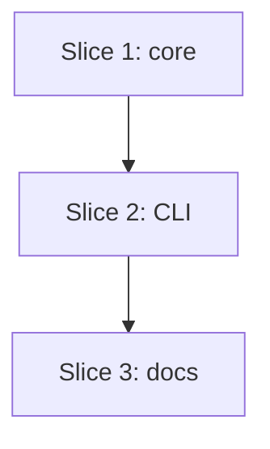

# Plan: Ask before sync removes packages (#55)

**Created**: 2026-11-26
**Branch**: slice/55-sync-asks (from integration/fork 60923a4)
**Status**: approved
**Gherkin persistence**: plan-file-only
<!-- As in #54: /build writes tests/features/fork-adoption/55-sync-asks.feature
     as the first, failing test of Slice 2 and adds it to FEATURE_FILES in
     tests/acceptance.rs. -->

## Goal

Today `lvpm sync` removes every installed package that lvpm.lock does not keep,
without asking. It also writes lvpm.lock before it shows the plan. A user who
syncs a project with a stray package in the destination (one installed by hand,
or by another project on a shared LabVIEW) loses it with no chance to say no.

After this change, `lvpm sync` (and a bare `lvpm install`, which syncs) shows
the plan and asks before it removes a package. Answering "n" leaves the
destination and lvpm.lock as they were. Scope is labview-package-manager/lvpm#55;
#50 (docs for a project without a lock) follows it.

This ships as ONE PR into `integration/fork`, squashed, with three commit groups
(one per slice).

## The rule

The question is put only for removals with reason `NotInLock` (see the open
decision below). Below, "a removal" means one of those.

| Situation | Behaviour |
|---|---|
| no removal planned | no question; sync as today |
| `--dry-run` | lists and stops, as today; no question, never refused |
| `--yes` or `LVPM_YES` | no question; goes ahead |
| stdin is a terminal, not `--json` | plan printed, then the question; "y"/"yes" goes ahead, anything else (empty, EOF) changes nothing |
| no terminal or `--json`, a venv or `--prefix` | no question; goes ahead |
| no terminal or `--json`, headless LabVIEW without `--global` | no question; goes ahead (headless counts as consent, as in #54) |
| no terminal or `--json`, `--global` | fails before any change, naming the packages, the target and `--yes` |

Precedence, top to bottom: no removal, then `--dry-run`, then `--yes`, then the
terminal rows. `global` is `env.flags.global`, what the user typed, as in #54.

In three lines, for the docs: sync asks before it removes a package the lock
does not keep. Without a terminal it goes ahead, except that `--global` needs
`--yes`. `--yes` or `LVPM_YES=1` answers yes.

Decided with the user:
- 2026-11-22 (in the issue): ask only when something would be removed; the plan is worked out in memory, so "n" leaves lvpm.lock as it was; no terminal goes ahead, except `--global` needs `--yes`; `--yes` and `LVPM_YES` answer.
- 2026-11-26: (1) a headless LabVIEW sync without `--global` needs no `--yes`; (2) `--json` follows the no-terminal rule; (3) only `sync` and a bare `install` ask. A named `install`/`uninstall`/`add`/`remove` does not ask, and the #54 `--global` guard stays as it is; (4) removals only, not version replacements.

How Python's uv does it, for comparison: `uv sync` never asks. It removes extraneous packages unless `--inexact` is given.

## Stances I took (not the user's decisions; open at the gate)

- **Which removals ask: `NotInLock` only.** `DevOnly` (`--no-dev`) and `GroupsOnly` (group selection) follow from flags the user just typed, so they do not ask. A scenario pins that `--no-dev` removes without asking.
- **"n" exits 0.** It prints `sync cancelled: nothing was changed` and a `next:` hint (`add it to lvpm.toml with 'lvpm add extra', or run 'lvpm sync --prefix dest --yes'`). The hint repeats the flags the user typed. With more than one package it drops the `add` half and says `add them to lvpm.toml`. The `--global` refusal names the same two ways out. This matches `venv remove`. A script never sees the question, because without a terminal there is none, so `lvpm sync && build` is not at risk.
- **The question** is `remove 2 packages (extra 1.0, zeta 0.3)? [y/N] ` on stderr. It names at most 5 packages and then `and N more`. For `--global` it names the LabVIEW target: `remove 1 package from LabVIEW 2026 (64-bit) (extra 1.0)? [y/N] `. The full plan (including any `--no-dev` removals and replacements, which "y" also runs) ends on the line just above the question, and "n" cancels all of it.
- **The plan is printed once,** before the question, and not again after "y". On a sync that will ask, the `SyncMigration` note ("removing ...") is skipped, since the question says it. Where nothing asks (add/remove's commit, `--yes`, no terminal), the note stays.
- **Core takes no input.** `ops::sync::sync_asking(env, opts, ask)` takes a front-end callback, as `uninstall`'s `Dependencies::Ask` does. `sync(env, opts)` stays and passes "always yes", so its callers do not change.
- **"In a terminal" means stdin is a terminal.** Debug builds honour a new `LVPM_TEST_STDIN_TERMINAL` override, kept apart from `LVPM_TEST_TERMINAL` (which means "output is a terminal" and turns on the update notice). `cmd_uninstall` uses the same helper.
- **The lock is written after the fetch,** with `begin_unpack` just before it, as add/remove's `commit` already does. A failed fetch then leaves lvpm.lock unchanged too. This resolves the `shortcut:` comment in `new_lock`.

## Acceptance Criteria

- [ ] In a terminal, a sync that would remove a `NotInLock` package prints the plan, then asks `remove N package(s) (name version, ...)? [y/N]`.
- [ ] "n", an empty answer and EOF leave the destination and lvpm.lock untouched: a missing lock stays missing, a present one is byte-for-byte the same. The output says `sync cancelled: nothing was changed` with a `next:` hint, and the exit code is 0.
- [ ] "y", "Y", "yes" go ahead: the package is gone and lvpm.lock is written.
- [ ] `--yes` and `LVPM_YES=1` go ahead without asking; `LVPM_YES=0` still asks.
- [ ] A sync with nothing to remove never asks, even in a terminal. A sync that only replaces a version never asks.
- [ ] A sync whose only removals come from `--no-dev` never asks.
- [ ] Without `--global`, a sync with no terminal or under `--json` (venv, prefix, headless LabVIEW) goes ahead without asking. Tested by acceptance (prefix) and a `sync_ask` unit test (venv, headless).
- [ ] With no terminal or under `--json`, a `--global` sync without `--yes` that would remove a `NotInLock` package fails before any write or fetch (a core test checks neither happened). The error names the packages, the target as lvpm prints it (e.g. `LabVIEW 2026 (64-bit)`) and `--yes`. A `--global` sync with nothing to remove is not refused.
- [ ] `LVPM_YES` follows docs/usage.md: `0`, `false`, `no`, `off` and empty are off; any other value is on.
- [ ] The plan line comes before the question (core event-order test, and the acceptance output order).
- [ ] The decline prints `next:` with `lvpm add` and the user's own flags plus `--yes`; one acceptance row asserts the `next:` line.
- [ ] `--dry-run` lists the removals, asks nothing, changes nothing, and is never refused.
- [ ] Named `install`, `uninstall`, `add` and `remove` never ask, and do what they did before. The baseline outcomes are observed on today's build before Slice 2 and recorded in the plan; until then those rows are provisional.
- [ ] A fetch failure after "y" leaves lvpm.lock as it was: an outdated lock byte-for-byte, a missing lock still missing.
- [ ] docs/specs/lvpm-unattended-s10d.md no longer contains "`sync` has no prompt" and contains "sync asks before it removes a package the lock does not keep". The `--yes` help reads "Answer yes to every question, including sync's question before it removes packages". Both are asserted by a test.

## Slices

### Slice 1: core holds the lock in memory and asks through a callback

**Depends-on:** none
**Files:** `crates/lvpm-core/src/ops/sync.rs`, `crates/lvpm-core/src/ops/lock.rs`, `crates/lvpm-core/src/ops/add_remove.rs`, `crates/lvpm-core/src/events.rs`, `src/render/mod.rs`, `tests/golden/**`

**Behavior** (core unit tests; the steps name the callback because it is core's contract):

```gherkin
Feature: sync decides on removals before it changes anything

  Scenario: a declined sync writes no lock and removes nothing
    Given a project with no lvpm.lock and an installed package the manifest does not lead to
    When a sync runs whose question is answered "no"
    Then no lvpm.lock exists
    And the package is still installed
    And the sync reports that it was declined

  Scenario: a declined sync leaves an outdated lock as it was
    Given a project whose lvpm.lock is outdated and an installed package the new lock drops
    When a sync runs whose question is answered "no"
    Then lvpm.lock is byte-for-byte as it was

  Scenario: an accepted sync goes ahead
    Given an installed package lvpm.lock does not list
    When a sync runs whose question is answered "yes"
    Then the package is no longer installed and lvpm.lock is written

  Scenario: the question gets exactly the removals that ask
    Given installed packages "extra" and "zeta" that lvpm.lock does not list
    When a sync runs whose question records what it is given and answers "no"
    Then the question was put once, with "extra" and "zeta"

  Scenario: a failing question stops the sync before any change
    Given an installed package lvpm.lock does not list and a project with no lvpm.lock
    When a sync runs whose question fails with "needs --yes"
    Then the sync returns that error
    And no lvpm.lock exists and the package is still installed

  Scenario Outline: no question is put
    Given <state>
    When <sync>
    Then the question is not put

    Examples:
      | state                                                   | sync                       |
      | a lock that lists one package that is not installed     | a sync runs                |
      | an installed package the new lock replaces with 2.0     | a sync runs                |
      | an installed dev-only package                           | a sync without dev runs    |
      | an installed package lvpm.lock does not list            | a dry-run sync runs        |

  Scenario: a fetch failure after "yes" leaves the lock as it was
    Given a project whose lvpm.lock is outdated and an archive that fails to fetch
    When a sync runs whose question is answered "yes"
    Then the sync fails and lvpm.lock is byte-for-byte as it was

  Scenario: add and remove print their plan once, as before
    Given an add that removes a package
    When it commits
    Then exactly one plan event is emitted, after the lock-written event
```

**Steps:**

#### Step 1.1: a pending lock, written after the fetch

**Complexity**: complex
**IMPLEMENT**:
- In lock.rs, add `PendingLock { path, text, changes, after }` with one `write(self, env)`. It runs `begin_unpack`, `write_atomically` and `announce_written`. `lock()` uses it, so there are two users.
- `settle_lock` returns `Settled { lock, first_sync, pending: Option<PendingLock> }`.
- `new_lock` always goes through `relock`. It serialises the text up front, so a `to_toml` failure shows before any question. On a dry run it still emits `LockWouldChange` and returns no pending write.
- `sync` writes the pending lock after `fetch_locked` and before `apply_sync`, the order `commit` uses. The empty-plan early return writes it too, before the palette merge and `SyncNothingToDo`. Both paths call one helper, `Settled::write_lock(env)`, so there is one write site.
- `PendingLock`'s doc says it writes the lock alone, with no manifest and no rollback. That is why `commit` and `upgrade` keep `write_manifest_and_lock`.
- `begin_unpack` moves out of `apply_sync` into its callers, just before the first write. In `sync` that is the lock write, or `apply_sync` when there is no pending lock. `commit` already calls it.

**TEST**:
- A first sync writes the lock after the fetch.
- A first sync, and an outdated lock, whose destination already matches the new lock still write lvpm.lock (empty-plan path).
- A fetch failure leaves an outdated lock byte-for-byte the same.
- A cancel before the fetch is still honoured, and one after the lock write is refused.
- An event-order test pins `SyncPlanned`, then the fetch progress, then the lock-written event.
- The existing sync tests stay green.
- The goldens that change because of the order are updated here.
**REFACTOR**: Remove the `shortcut:` comment in `new_lock`, whose limit is now gone.
**Files**: `crates/lvpm-core/src/ops/lock.rs`, `crates/lvpm-core/src/ops/sync.rs`, `tests/golden/**`
**Commit**: `refactor(sync): write a new lock after the fetch, as add and remove do (#55)`

#### Step 1.2: sync_asking, called only when a NotInLock removal is planned

**Complexity**: standard
**IMPLEMENT**:
- `sync_asking(env, opts, ask: &dyn Fn(&[SyncStep]) -> anyhow::Result<Answer>)`, where `Answer { Asked(bool), NotAsked }`. `NotAsked` means the front end went ahead without a question (`--yes`, no terminal). The callback gets the `Remove` steps whose reason is `NotInLock`, so the front end can name versions. One fn, `removals_to_ask(plan)`, builds that list; `announce_migration`, the callback and `SyncDeclined` all use it. `sync(env, opts)` wraps it with `&|_| Ok(true)`. `cmd_sync` is the only caller of `sync_asking`, so `tests/steps/cancel.rs` and `hook_policy.rs` do not change.
- `SyncPlanned { dry_run: false }` moves out of `apply_sync`. `sync` emits it before the question. `commit` in add_remove.rs emits it itself, right before its `apply_sync`, after `announce_written`, so the order it emits in stays the same.
- The callback is called after the plan event and before any write or fetch.
- A "no" emits `Event::SyncDeclined { removing }` and returns Ok.
- An `Err` from the callback returns as `SyncError::Other` with nothing changed.
- On a sync with removals to ask about, `sync` emits the `SyncMigration` note after the callback, and only on `NotAsked`. A question already says it, and "n" must not be preceded by "removing ...". With nothing to ask about, the note stays where it is today.
- src/render/mod.rs gets the `SyncDeclined` arm. Its wording is set in Step 2.2.

**TEST**:
- The callback is not called with nothing to remove, on a version replacement, on a `--no-dev` removal, or on a dry run.
- It is called once with exactly the `NotInLock` removals.
- "no" leaves the install records and lock unchanged and emits `SyncDeclined`.
- `Err` aborts before any write.
- `SyncPlanned` is emitted once on each path.
- add/remove still emit exactly one `SyncPlanned`, in the same position.
**REFACTOR**: Update the `sync` doc comment, which says "asking nothing". Reword the `refuse_foreign_packages` comment in add_remove.rs: #55 left named add/remove guarded on purpose (user decision 3).
**Files**: `crates/lvpm-core/src/ops/sync.rs`, `crates/lvpm-core/src/ops/add_remove.rs`, `crates/lvpm-core/src/events.rs`, `src/render/mod.rs`
**Commit**: `feat(sync): ask the front end before removing (#55)`

### Slice 2: the CLI asks, goes ahead or refuses

**Depends-on:** 1
**Files:** `src/main.rs`, `src/render/mod.rs`, `src/render/sync.rs`, `tests/features/fork-adoption/55-sync-asks.feature`, `tests/acceptance.rs`, `tests/steps/*.rs`, `tests/support/*.rs`, `crates/lvpm-core/src/ops/sync.rs`, `tests/golden/**`

**Behavior:**

```gherkin
Feature: sync asks before it removes packages
  labview-package-manager/lvpm#55.

  Background:
    Given fixture packages "alpha" 1.0, "alpha" 2.0, "extra" 1.0 and "zeta" 1.0
    And a project whose lvpm.toml says labview = ">=2026"
    And the project depends on "alpha" ">=1.0"
    And the project has no lvpm.lock

  Scenario Outline: sync asks before removing, and "no" changes nothing
    Given dest has "alpha" 1.0 and "extra" 1.0 installed
    When I run "lvpm sync --prefix dest" in a terminal and answer "<answer>"
    Then it asked "remove 1 package (extra 1.0)? [y/N]"
    And the command succeeds
    And the output says "sync cancelled: nothing was changed"
    And dest's lvpm-installed packages are exactly "alpha" 1.0 and "extra" 1.0
    And the project has no lvpm.lock

    Examples:
      | answer    |
      | n         |
      | no        |
      |           |
      | yes please|

  Scenario: a closed stdin is "no"
    Given dest has "alpha" 1.0 and "extra" 1.0 installed
    When I run "lvpm sync --prefix dest" in a terminal with stdin closed
    Then it asked "[y/N]"
    And dest's lvpm-installed packages are exactly "alpha" 1.0 and "extra" 1.0

  Scenario: "n" leaves an existing lvpm.lock byte-for-byte
    Given dest has "alpha" 1.0 and "extra" 1.0 installed
    And the project has an lvpm.lock locking only "alpha" 1.0
    When I run "lvpm sync --prefix dest" in a terminal and answer "n"
    Then the project's lvpm.lock is unchanged
    And dest's lvpm-installed packages are exactly "alpha" 1.0 and "extra" 1.0

  Scenario Outline: "y" goes ahead
    Given dest has "alpha" 1.0 and "extra" 1.0 installed
    When I run "lvpm sync --prefix dest" in a terminal and answer "<answer>"
    Then it asked "[y/N]"
    And the command succeeds
    And dest's lvpm-installed packages are exactly "alpha" 2.0
    And the project has an lvpm.lock

    Examples:
      | answer |
      | y      |
      | Y      |
      | yes    |

  Scenario: the question names every package it would remove
    Given dest has "alpha" 1.0, "extra" 1.0 and "zeta" 1.0 installed
    When I run "lvpm sync --prefix dest" in a terminal and answer "n"
    Then it asked "remove 2 packages (extra 1.0, zeta 1.0)? [y/N]"

  Scenario Outline: --yes and LVPM_YES answer the question
    Given dest has "alpha" 1.0 and "extra" 1.0 installed
    And LVPM_YES is set to "<env>"
    When I run "<command>" in a terminal
    Then it did not ask "[y/N]"
    And dest's lvpm-installed packages are exactly "alpha" 2.0

    Examples:
      | command                        | env |
      | lvpm sync --prefix dest --yes  |     |
      | lvpm sync --prefix dest        | 1   |

  Scenario: a falsey LVPM_YES still asks
    Given dest has "alpha" 1.0 and "extra" 1.0 installed
    And LVPM_YES is set to "0"
    When I run "lvpm sync --prefix dest" in a terminal and answer "n"
    Then it asked "[y/N]"

  Scenario Outline: nothing to remove, nothing to ask
    Given <dest>
    When I run "lvpm sync --prefix dest" in a terminal
    Then it did not ask "[y/N]"
    And the command succeeds
    And dest's lvpm-installed packages are exactly "alpha" 2.0

    Examples:
      | dest                                |
      | an empty dest                       |
      | dest has "alpha" 1.0 installed      |
      | dest has "alpha" 2.0 installed      |

  Scenario: a bare install asks the same way
    Given dest has "alpha" 1.0 and "extra" 1.0 installed
    When I run "lvpm install --prefix dest" in a terminal and answer "n"
    Then it asked "[y/N]"
    And dest's lvpm-installed packages are exactly "alpha" 1.0 and "extra" 1.0

  Scenario: with no terminal, a prefix goes ahead
    Given dest has "alpha" 1.0 and "extra" 1.0 installed
    When I run "lvpm sync --prefix dest" with no terminal
    Then it did not ask "[y/N]"
    And the output names "extra" as a package to remove
    And dest's lvpm-installed packages are exactly "alpha" 2.0

  Scenario: --json in a terminal does not ask
    Given dest has "alpha" 1.0 and "extra" 1.0 installed
    When I run "lvpm sync --prefix dest --json" in a terminal
    Then it did not ask "[y/N]"
    And dest's lvpm-installed packages are exactly "alpha" 2.0

  Scenario Outline: named commands do not ask
    Given dest has "alpha" 1.0 and "extra" 1.0 installed
    When I run "<command>" in a terminal
    Then it did not ask "[y/N]"
    And <outcome>

    Examples:
      | command                                  | outcome                                                   |
      | lvpm install zeta --prefix dest          | dest's lvpm-installed packages are exactly "alpha" 2.0 and "zeta" 1.0 |
      | lvpm uninstall alpha --prefix dest       | dest's lvpm-installed packages are exactly "extra" 1.0     |
      | lvpm add zeta --prefix dest              | the manifest depends on "zeta"                             |
      | lvpm remove alpha --prefix dest          | the manifest no longer depends on "alpha"                  |

  Scenario: --dry-run lists and asks nothing
    Given dest has "alpha" 1.0 and "extra" 1.0 installed
    When I run "lvpm sync --prefix dest --dry-run" in a terminal
    Then it did not ask "[y/N]"
    And the output names "extra" as a package to remove
    And dest's lvpm-installed packages are exactly "alpha" 1.0 and "extra" 1.0

  Scenario: a dev-only removal does not ask
    Given the project dev-depends on "zeta" ">=1.0"
    And dest has "alpha" 2.0 and "zeta" 1.0 installed
    When I run "lvpm sync --prefix dest --no-dev" in a terminal
    Then it did not ask "[y/N]"
    And dest's lvpm-installed packages are exactly "alpha" 2.0
```

The named-command outcomes are what each command does today with an unlocked
`extra` in dest. Before Slice 2, /build runs the four commands on today's build
and pastes the observed outcomes into the table. The point of each row is "no question", not a new
behaviour.

The `--global` refusal has no acceptance scenario: the harness cannot point a
LabVIEW target at a throwaway directory (the same limit #54 hit). It is covered
by the Slice 1 callback-`Err` scenario and the Step 2.1/2.2 unit tests.

**Steps:**

#### Step 2.1: the decision, as one pure function

**Complexity**: standard
**IMPLEMENT**:
- `fn on_removal(yes, json, terminal, global) -> Removal { GoAhead, Ask, Refuse }` in src/main.rs.
- `fn stdin_is_terminal() -> bool` wraps `IsTerminal` and the debug-only `LVPM_TEST_STDIN_TERMINAL`. `cmd_uninstall` switches to it.
- Share only the read-and-parse part with `confirm_dependencies`: `read_yes(input, output, question) -> Result<bool>`, where y/yes in any case is true and anything else or EOF is false. `confirm_dependencies` keeps its own "no terminal" check and wording. `confirm_removal` (`venv remove`) is not touched.

**TEST**:
- All 16 combinations of `on_removal` against an explicit expected table.
- `read_yes` with y, Y, yes, YES, n, "", EOF and "yes please".
- The existing `confirm_dependencies` tests stay green.
**REFACTOR**: none expected.
**Files**: `src/main.rs`
**Commit**: `feat(sync): decide when sync asks, goes ahead or refuses (#55)`

#### Step 2.2: wire cmd_sync, render the question and the cancel

**Complexity**: standard
**IMPLEMENT**:
- `cmd_sync` builds the ask closure from Step 2.1 and calls `sync_asking`. It serves both `sync` and the bare `install` route (main.rs:1070, 1083).
- `Ask` prints the question on stderr and reads stdin.
- `Refuse` returns the error below. It travels as `SyncError::Other`, and the step checks that `render::sync::error` and `headless_error` print it whole:
  ```
  sync would remove 1 package from LabVIEW 2026 (64-bit): extra 1.0
  (no terminal to ask in | --json gives no terminal to ask in)
  next: lvpm sync --global --yes
  ```
- `SyncDeclined` renders as text only. Under `--json` the question is never put, so it gets no JSON rendering.

**TEST**:
- Write 55-sync-asks.feature first and see it fail.
- Add the steps "in a terminal" (sets `LVPM_TEST_STDIN_TERMINAL`, and leaves `LVPM_TEST_TERMINAL` unset so the update notice stays off), "in a terminal with stdin closed", "with no terminal", "LVPM_YES is set to" and "the project has an lvpm.lock locking only".
- Reuse `it asked`/`it did not ask`.
- Add the file to FEATURE_FILES. Then make it pass.
- The ask logic is a named function, `sync_ask(decision, target, input, output) -> impl Fn(&[SyncStep]) -> Result<Answer>`, taking the reader and writer as `confirm_dependencies` does. Its Ask path is tested with a fake reader, so it can be tested outside `cmd_sync`. Unit tests: `global=true` with no terminal, and `global=true` under `--json`. Each returns an `Err` containing "extra 1.0", the target and "--yes".
- The refusal rendered through `render::sync::error` and `headless_error` matches the Step 2.3 golden.
- A unit test that dry-run with `global=true` and no terminal is not refused.
- A unit test of the options-to-`global` mapping: `--prefix` false, a venv false, headless without `--global` false, `--global` true.
- The `LVPM_YES is set to` step treats an empty cell as unset, and every scenario starts with `LVPM_YES` cleared.
**REFACTOR**: Bring the existing "will be removed" wording in render/sync.rs in line with the question. The plan text stays in the future tense, since a fetch can now fail after it is printed.
**Files**: `src/main.rs`, `src/render/mod.rs`, `src/render/sync.rs`, `tests/features/fork-adoption/55-sync-asks.feature`, `tests/acceptance.rs`, `tests/steps/*.rs`, `tests/support/*.rs`
**Commit**: `feat(sync): ask before removing in a terminal; --global needs --yes without one (#55)`

#### Step 2.3: goldens and the tests whose names now lie

**Complexity**: standard
**IMPLEMENT**:
- Update tests that expect a removal "without a question", e.g. `an_extra_package_is_announced_and_then_removed_without_a_question` in sync.rs.
- Add a golden for the decline output and one for the `--global` refusal.
- `tests/venv.rs` runs with no terminal: it must have no diff and pass.
**TEST**: `cargo test --workspace` green; `git diff --stat tests/venv.rs` is empty.
**REFACTOR**: Rename the tests whose names now lie.
**Files**: `crates/lvpm-core/src/ops/sync.rs`, `tests/golden/**`
**Commit**: `test(sync): record the decline and the --global refusal (#55)`

### Slice 3: docs

**Depends-on:** 2
**Files:** `docs/specs/lvpm-unattended-s10d.md`, `docs/**/*.md`, `src/main.rs`

#### Step 3.1: say it where sync is described

**Complexity**: trivial
**IMPLEMENT**:
- Replace "`sync` has no prompt" in docs/specs/lvpm-unattended-s10d.md with the three-line rule and the table.
- Update the book's sync pages: grep `docs/` for `lvpm sync` and "will be removed". Say that stdin must be a terminal, and that `--no-dev` and group removals do not ask.
- Change the `--yes` help text in src/main.rs to say it answers sync's question too.
**TEST**: `grep -c 'has no prompt' docs/specs/lvpm-unattended-s10d.md` is 0. The `--yes` help text holds the exact new sentence, asserted in the help golden that /build names before the step. Full suite green.
**REFACTOR**: none beyond wording.
**Files**: `docs/specs/lvpm-unattended-s10d.md`, `docs/**/*.md`, `src/main.rs`
**Commit**: `docs(sync): sync asks before removing (#55)`

## Parallelization



| Wave | Slices (parallel) |
|------|-------------------|
| 1 | 1 |
| 2 | 2 |
| 3 | 3 |

## Complexity Classification

| Rating | Criteria | Review depth |
|--------|----------|--------------|
| `trivial` | docs only | final `/code-review` |
| `standard` | behaviour within existing patterns | spec-compliance + relevant quality agents |
| `complex` | moves when the lock is written; cancel guard | full agent suite |

## Pre-PR Quality Gate

- [ ] `cargo test --workspace` passes
- [ ] `cargo clippy --workspace --all-targets -- -D warnings` passes
- [ ] `cargo fmt --check` passes
- [ ] `/code-review --since org/integration/fork` passes

## Skipped (low value)

- A pty-based acceptance test of a real terminal: the stdin override exists for exactly this, and `read_yes` is unit-tested.
- A JSON rendering of `SyncDeclined`: under `--json` nothing asks, so it could never be emitted.

## Risks & Open Questions

- Open at the gate: `NotInLock`-only asking, the decline exit code 0, and skipping the `SyncMigration` note when asking (see Stances).
- The lock is now written after the fetch, and `SyncPlanned` moves out of `apply_sync`. Event order changes on sync; the goldens show it (Step 1.1). Add/remove keep their order (Step 1.2 test).
- #68 runs in parallel and also touches `settle_lock`, `sync` and `apply_sync` (group selection). Expect real conflicts. If #68 merges first, this branch rebases before Slice 1; if this merges first, #68 rebases.
- The `--global` refusal has unit tests only (harness limit).
- Follow-ups, not done here: asking on named install/uninstall/add/remove (user decision 3; the #54 guard stays); asking on version replacements (decision 4) for shared LabVIEW installs. I will list both in the PR body.

## Build Progress

### Wave 1
- [ ] Slice 1: core holds the lock in memory and asks through a callback
  - [x] Step 1.1: a pending lock, written after the fetch
  - [ ] Step 1.2: sync_asking, called only when a NotInLock removal is planned

### Wave 2
- [ ] Slice 2: the CLI asks, goes ahead or refuses
  - [ ] Step 2.1: the decision, as one pure function
  - [ ] Step 2.2: wire cmd_sync, render the question and the cancel
  - [ ] Step 2.3: goldens and the tests whose names now lie

### Wave 3
- [ ] Slice 3: docs
  - [ ] Step 3.1: say it where sync is described

## Plan Review Summary

Plan tier: complex (Step 1.1 moves the lock write and the cancel guard). Reviewers: all 5.

| Reviewer | Round 1 | Round 2 |
|---|---|---|
| Parallelization | approve | not re-run |
| Strategic | needs-revision (warnings only) | not re-run |
| Acceptance | needs-revision (3 blockers) | approve |
| UX | needs-revision (1 blocker) | approve |
| Design | needs-revision (1 blocker) | needs-revision (2 new blockers) |

The two round-2 design blockers are fixed in the text, but no third review ran (the limit is 2 rounds):
- The empty-plan early return now writes the pending lock too, through one `Settled::write_lock` helper.
- The `SyncMigration` skip is decided by an `Answer { Asked(bool), NotAsked }` callback result, not by core guessing.

Warnings left, for /build to keep in mind:
- The question counts only `NotInLock` removals; "y" also runs the rest of the plan printed just above it.
- The question goes to stderr but only stdin is checked for a terminal. Documented, not checked.
- The named-command outcomes are confirmed against today's build before Slice 2.
- #68 touches the same functions; expect conflicts.
